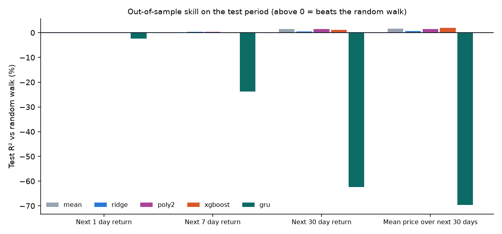
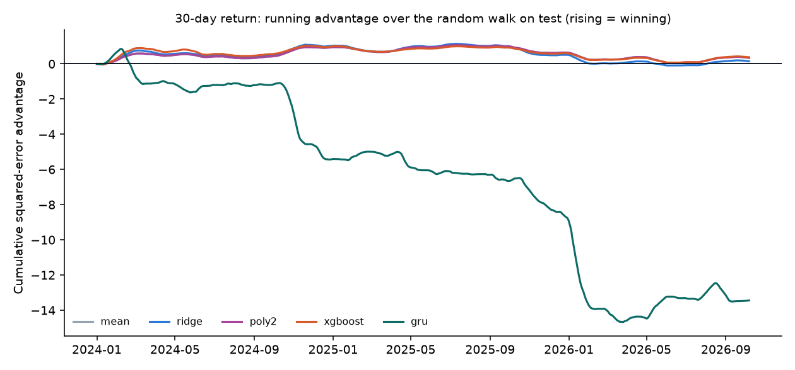

# Bitcoin model comparison: train, validate, test

Run: 2026-11-07 09:17 UTC · data collected 2026-11-07T08:54:47+00:00 · 47 of 48 series loaded · price base `btc` · runtime 14.4 min

**How to read this.** R²oos compares each model with the random-walk forecast (tomorrow's price = today's). 0 means no better than the random walk, negative means worse. The Diebold-Mariano p-value (DM p) tests whether a model beats the random walk by more than chance. A model should also beat the constant-drift forecast (the average past return, row `mean`). The overfit gap is in-sample R²oos minus test R²oos.

## Split

| Block | Period | Used for |
|---|---|---|
| Train | 2018-03-01 to 2022-12-31 | fitting |
| Validation | 2023-01-01 to 2023-12-31 | choosing hyperparameters and early stopping |
| Test | 2024-01-01 to latest | scored once, after refitting on train + validation |

## Next 1 day return (`r1`, 1 d)

Rows: train 1766, validation 365, test 1040 (2024-01-01 to 2026-11-05) · 189 features

| Model | Train R²oos | Val R²oos | Test R²oos | Test direction hit | Test DM p | Overfit gap | Half-years beating RW |
|---|---|---|---|---|---|---|---|
| zero | +0.00% | +0.00% | **+0.00%** | – | – | +0.00% | 0/6 |
| mean | +0.00% | +0.23% | **+0.04%** | 0.501 | 0.785 | -0.01% | 4/6 |
| ridge | +0.49% | -0.25% | **+0.05%** | 0.504 | 0.830 | +0.44% | 4/6 |
| poly2 | +4.84% | +0.69% | **+0.15%** | 0.486 | 0.812 | +4.62% | 3/6 |
| xgboost | +1.99% | +0.37% | **+0.14%** | 0.490 | 0.538 | +1.85% | 4/6 |
| ridge_fixed | +17.56% | -77.20% | **-132.22%** | 0.530 | 0.000 | +147.36% | 0/6 |
| poly2_fixed | +19.68% | -80.65% | **-30.76%** | 0.487 | 0.000 | +48.63% | 0/6 |
| xgb_fixed | +46.86% | -17.37% | **-2.79%** | 0.509 | 0.166 | +44.69% | 2/6 |
| gru | +2.44% | -1.46% | **-1.68%** | 0.508 | 0.107 | +5.29% | 0/6 |
| gru_fixed | +33.55% | -65.92% | **-47.71%** | 0.525 | 0.000 | +83.14% | 0/6 |

Ranking on test with overfitting flags:

- **poly2**: test R²oos +0.15%, DM p vs random walk 0.812, vs drift 0.858 · no risk flags
- **xgboost**: test R²oos +0.14%, DM p vs random walk 0.538, vs drift 0.466 · no risk flags
- **ridge**: test R²oos +0.05%, DM p vs random walk 0.830, vs drift 0.958 · no risk flags
- **gru**: test R²oos -1.68%, DM p vs random walk 0.107, vs drift 0.078 · risk: large in-sample vs test gap, loses to random walk in most half-years, no better than the constant-drift forecast

**Verdict:** no model beats both the random walk and the constant drift significantly without an overfitting flag.

Overfitting probes (fixed settings, no validation brake): ridge_fixed in-sample +15.1% → test -132.2%; poly2_fixed in-sample +17.9% → test -30.8%; xgb_fixed in-sample +41.9% → test -2.8%; gru_fixed in-sample +35.4% → test -47.7%

GRU test R²oos by seed: -2.55%, -1.93%, -1.39%, -2.57%, -1.95%

## Next 7 day return (`r7`, 7 d)

Rows: train 1760, validation 365, test 1034 (2024-01-01 to 2026-10-30) · 189 features

| Model | Train R²oos | Val R²oos | Test R²oos | Test direction hit | Test DM p | Overfit gap | Half-years beating RW |
|---|---|---|---|---|---|---|---|
| zero | +0.00% | +0.00% | **+0.00%** | – | – | +0.00% | 0/6 |
| mean | +0.03% | +1.24% | **+0.36%** | 0.518 | 0.716 | -0.15% | 4/6 |
| ridge | +2.39% | -1.03% | **+0.40%** | 0.516 | 0.758 | +1.97% | 4/6 |
| poly2 | +0.31% | +1.23% | **+0.34%** | 0.518 | 0.733 | +0.17% | 4/6 |
| xgboost | +0.80% | +1.57% | **+0.28%** | 0.518 | 0.777 | +0.56% | 3/6 |
| ridge_fixed | +56.82% | -122.57% | **-504.81%** | 0.516 | 0.000 | +556.12% | 0/6 |
| poly2_fixed | +47.54% | -53.33% | **-95.36%** | 0.437 | 0.000 | +138.32% | 0/6 |
| xgb_fixed | +81.19% | -116.35% | **-18.00%** | 0.521 | 0.001 | +94.23% | 1/6 |
| gru | +10.28% | +2.19% | **-22.01%** | 0.497 | 0.000 | +45.39% | 0/6 |
| gru_fixed | +90.97% | -267.80% | **-145.84%** | 0.472 | 0.000 | +237.04% | 0/6 |

Ranking on test with overfitting flags:

- **ridge**: test R²oos +0.40%, DM p vs random walk 0.758, vs drift 0.942 · no risk flags
- **poly2**: test R²oos +0.34%, DM p vs random walk 0.733, vs drift 0.268 · risk: no better than the constant-drift forecast
- **xgboost**: test R²oos +0.28%, DM p vs random walk 0.777, vs drift 0.427 · risk: no better than the constant-drift forecast
- **gru**: test R²oos -22.01%, DM p vs random walk 0.000, vs drift 0.000 · risk: large in-sample vs test gap, validation result did not hold on test, loses to random walk in most half-years, unstable across seeds, no better than the constant-drift forecast

**Verdict:** no model beats both the random walk and the constant drift significantly without an overfitting flag.

Overfitting probes (fixed settings, no validation brake): ridge_fixed in-sample +51.3% → test -504.8%; poly2_fixed in-sample +43.0% → test -95.4%; xgb_fixed in-sample +76.2% → test -18.0%; gru_fixed in-sample +91.2% → test -145.8%

GRU test R²oos by seed: -24.21%, -25.40%, -19.79%, -25.53%, -22.07%

## Next 30 day return (`r30`, 30 d)

Rows: train 1737, validation 365, test 1011 (2024-01-01 to 2026-10-07) · 189 features

| Model | Train R²oos | Val R²oos | Test R²oos | Test direction hit | Test DM p | Overfit gap | Half-years beating RW |
|---|---|---|---|---|---|---|---|
| zero | +0.00% | +0.00% | **+0.00%** | – | – | +0.00% | 0/6 |
| mean | +0.24% | +6.66% | **+1.75%** | 0.556 | 0.705 | -0.64% | 4/6 |
| ridge | +7.37% | -2.62% | **+0.76%** | 0.556 | 0.888 | +6.47% | 4/6 |
| poly2 | +0.68% | +6.61% | **+1.74%** | 0.556 | 0.709 | -0.17% | 4/6 |
| xgboost | +9.64% | +9.36% | **+1.94%** | 0.556 | 0.709 | +8.10% | 3/6 |
| ridge_fixed | +86.11% | -1418.43% | **-511.25%** | 0.503 | 0.000 | +592.73% | 0/6 |
| poly2_fixed | +69.32% | -148.71% | **-75.43%** | 0.423 | 0.000 | +138.65% | 0/6 |
| xgb_fixed | +95.60% | -96.64% | **-34.44%** | 0.583 | 0.054 | +128.73% | 1/6 |
| gru | +23.16% | +9.78% | **-69.21%** | 0.605 | 0.015 | +146.92% | 0/6 |
| gru_fixed | +97.51% | -94.99% | **-109.22%** | 0.586 | 0.001 | +206.56% | 0/6 |

Ranking on test with overfitting flags:

- **xgboost**: test R²oos +1.94%, DM p vs random walk 0.709, vs drift 0.899 · risk: large in-sample vs test gap, validation result did not hold on test
- **poly2**: test R²oos +1.74%, DM p vs random walk 0.709, vs drift 0.679 · risk: no better than the constant-drift forecast
- **ridge**: test R²oos +0.76%, DM p vs random walk 0.888, vs drift 0.434 · risk: large in-sample vs test gap, no better than the constant-drift forecast
- **gru**: test R²oos -69.21%, DM p vs random walk 0.015, vs drift 0.014 · risk: large in-sample vs test gap, validation result did not hold on test, loses to random walk in most half-years, unstable across seeds, no better than the constant-drift forecast

**Verdict:** no model beats both the random walk and the constant drift significantly without an overfitting flag.

Overfitting probes (fixed settings, no validation brake): ridge_fixed in-sample +81.5% → test -511.2%; poly2_fixed in-sample +63.2% → test -75.4%; xgb_fixed in-sample +94.3% → test -34.4%; gru_fixed in-sample +97.3% → test -109.2%

GRU test R²oos by seed: -87.53%, -70.04%, -104.26%, -90.98%, -83.51%

## Mean price over next 30 days (drives 50/100/200-day MA forecasts) (`m30`, 30 d)

Rows: train 1737, validation 365, test 1011 (2024-01-01 to 2026-10-07) · 189 features

| Model | Train R²oos | Val R²oos | Test R²oos | Test direction hit | Test DM p | Overfit gap | Half-years beating RW |
|---|---|---|---|---|---|---|---|
| zero | +0.00% | +0.00% | **+0.00%** | – | – | +0.00% | 0/6 |
| mean | +0.47% | +8.10% | **+1.70%** | 0.542 | 0.719 | -0.35% | 4/6 |
| ridge | +6.24% | +2.11% | **+0.90%** | 0.542 | 0.867 | +5.54% | 4/6 |
| poly2 | +0.60% | +8.03% | **+1.72%** | 0.542 | 0.716 | -0.23% | 4/6 |
| xgboost | +5.95% | +8.37% | **+1.58%** | 0.542 | 0.743 | +4.79% | 4/6 |
| ridge_fixed | +85.69% | -817.32% | **-338.25%** | 0.536 | 0.000 | +419.08% | 0/6 |
| poly2_fixed | +66.29% | -67.80% | **-95.26%** | 0.416 | 0.000 | +155.57% | 0/6 |
| xgb_fixed | +95.43% | -145.62% | **-50.08%** | 0.549 | 0.020 | +143.63% | 2/6 |
| gru | +18.72% | +12.96% | **-73.49%** | 0.521 | 0.003 | +144.55% | 1/6 |
| gru_fixed | +98.79% | -212.87% | **-162.03%** | 0.525 | 0.000 | +260.79% | 0/6 |

Ranking on test with overfitting flags:

- **poly2**: test R²oos +1.72%, DM p vs random walk 0.716, vs drift 0.337 · risk: validation result did not hold on test
- **xgboost**: test R²oos +1.58%, DM p vs random walk 0.743, vs drift 0.794 · risk: validation result did not hold on test, no better than the constant-drift forecast
- **ridge**: test R²oos +0.90%, DM p vs random walk 0.867, vs drift 0.487 · risk: large in-sample vs test gap, no better than the constant-drift forecast
- **gru**: test R²oos -73.49%, DM p vs random walk 0.003, vs drift 0.003 · risk: large in-sample vs test gap, validation result did not hold on test, loses to random walk in most half-years, unstable across seeds, no better than the constant-drift forecast

**Verdict:** no model beats both the random walk and the constant drift significantly without an overfitting flag.

Overfitting probes (fixed settings, no validation brake): ridge_fixed in-sample +80.8% → test -338.2%; poly2_fixed in-sample +60.3% → test -95.3%; xgb_fixed in-sample +93.5% → test -50.1%; gru_fixed in-sample +98.8% → test -162.0%

GRU test R²oos by seed: -91.00%, -72.63%, -101.77%, -104.19%, -74.63%

## Walk-forward check (refit every 91 days, 2020 onwards)

Each quarter the models are re-tuned on the trailing year and refit on all earlier data, then forecast the next quarter. This tests the same models over about 25 different periods instead of one.

**Next 1 day return** · 25 folds, 2020-09-30 to 2026-11-05

| Model | R²oos | DM p vs random walk | DM p vs drift | 2020 | 2021 | 2022 | 2023 | 2024 | 2025 | 2026 |
|---|---|---|---|---|---|---|---|---|---|---|
| zero | **+0.00%** | – | – | +0.0% | +0.0% | +0.0% | +0.0% | +0.0% | +0.0% | +0.0% |
| mean | **-0.08%** | 0.487 | – | +0.0% | -0.0% | -0.5% | +0.3% | +0.3% | -0.2% | -0.2% |
| ridge | **-0.59%** | 0.184 | 0.226 | -0.2% | -0.8% | -0.8% | -1.4% | +0.3% | -0.6% | -0.3% |
| poly2 | **-0.59%** | 0.314 | 0.352 | +0.1% | +0.4% | -2.1% | -1.8% | -0.1% | -0.0% | -1.1% |
| xgboost | **-0.46%** | 0.511 | 0.591 | -0.6% | -0.0% | -0.6% | +0.0% | -0.7% | -1.8% | -0.4% |

**Next 7 day return** · 25 folds, 2020-09-30 to 2026-10-30

| Model | R²oos | DM p vs random walk | DM p vs drift | 2020 | 2021 | 2022 | 2023 | 2024 | 2025 | 2026 |
|---|---|---|---|---|---|---|---|---|---|---|
| zero | **+0.00%** | – | – | +0.0% | +0.0% | +0.0% | +0.0% | +0.0% | +0.0% | +0.0% |
| mean | **-0.63%** | 0.366 | – | +0.2% | -0.7% | -3.1% | +1.6% | +2.2% | -2.1% | -1.8% |
| ridge | **-2.21%** | 0.101 | 0.235 | +1.8% | -4.6% | -2.3% | -4.3% | +2.6% | -2.7% | -2.2% |
| poly2 | **-2.74%** | 0.292 | 0.381 | +2.6% | +1.9% | -5.8% | -17.0% | +0.7% | -1.9% | -3.4% |
| xgboost | **-6.88%** | 0.024 | 0.033 | +4.3% | -2.0% | -12.3% | -31.2% | +1.4% | -6.1% | -1.9% |

**Next 30 day return** · 25 folds, 2020-09-30 to 2026-10-07

| Model | R²oos | DM p vs random walk | DM p vs drift | 2020 | 2021 | 2022 | 2023 | 2024 | 2025 | 2026 |
|---|---|---|---|---|---|---|---|---|---|---|
| zero | **+0.00%** | – | – | +0.0% | +0.0% | +0.0% | +0.0% | +0.0% | +0.0% | +0.0% |
| mean | **-2.23%** | 0.465 | – | +2.7% | -5.2% | -13.7% | +7.8% | +9.6% | -12.2% | -6.0% |
| ridge | **-15.43%** | 0.037 | 0.064 | +3.6% | -20.2% | -2.8% | -103.7% | +10.2% | -19.6% | -6.1% |
| poly2 | **-14.34%** | 0.029 | 0.033 | +2.7% | -6.1% | -57.8% | -26.7% | +7.0% | -15.6% | -14.0% |
| xgboost | **-23.58%** | 0.023 | 0.016 | +1.1% | -69.2% | -10.6% | -4.7% | +4.2% | -57.6% | -5.7% |

**Mean price over next 30 days (drives 50/100/200-day MA forecasts)** · 25 folds, 2020-09-30 to 2026-10-07

| Model | R²oos | DM p vs random walk | DM p vs drift | 2020 | 2021 | 2022 | 2023 | 2024 | 2025 | 2026 |
|---|---|---|---|---|---|---|---|---|---|---|
| zero | **+0.00%** | – | – | +0.0% | +0.0% | +0.0% | +0.0% | +0.0% | +0.0% | +0.0% |
| mean | **-1.22%** | 0.671 | – | +4.6% | -3.4% | -14.1% | +8.7% | +8.8% | -10.5% | -5.5% |
| ridge | **-6.73%** | 0.198 | 0.220 | +5.9% | -16.8% | -0.5% | -28.8% | +8.9% | -15.4% | -5.4% |
| poly2 | **-8.93%** | 0.051 | 0.039 | +5.1% | -6.1% | -34.0% | -21.4% | +5.4% | -9.8% | -7.7% |
| xgboost | **-25.32%** | 0.034 | 0.024 | +2.9% | -61.4% | -8.9% | -58.2% | +9.6% | -39.6% | -7.1% |

## 50/100/200-day moving averages, 30 days ahead

Forecast = known part of the average + 30 predicted days (from the `m30` model). The naive forecast fills the 30 unknown days with today's price.

| Model | MA50 error | MA100 error | MA200 error | MA50 vs naive | MA100 vs naive | MA200 vs naive |
|---|---|---|---|---|---|---|
| gru | 4.90% | 2.50% | 1.29% | 1.346× | 1.339× | 1.327× |
| gru_fixed | 5.99% | 3.08% | 1.60% | 1.644× | 1.647× | 1.646× |
| mean | 3.68% | 1.88% | 0.98% | 1.010× | 1.006× | 1.008× |
| poly2 | 3.68% | 1.88% | 0.98% | 1.010× | 1.006× | 1.007× |
| poly2_fixed | 5.35% | 2.72% | 1.41% | 1.470× | 1.457× | 1.444× |
| ridge | 3.72% | 1.90% | 0.99% | 1.022× | 1.019× | 1.020× |
| ridge_fixed | 8.14% | 4.15% | 2.15% | 2.234× | 2.219× | 2.204× |
| xgb_fixed | 4.98% | 2.52% | 1.32% | 1.368× | 1.349× | 1.350× |
| xgboost | 3.68% | 1.88% | 0.98% | 1.011× | 1.008× | 1.008× |
| zero | 3.64% | 1.87% | 0.97% | 1.000× | 1.000× | 1.000× |

The naive forecast alone already explains MA50 96.2%, MA100 99.1%, MA200 99.8% of the variation in moving-average levels on test, so high R² on moving averages says nothing about skill.

## XGBoost: most used features (gain, final refit)

- `r1`: btc_ma_gap_20, fed_funds_chg_7, news_tone_conflict_lvl, btc_ma_gap_100, cm_exchange_supply_chg_7, ust10y_z365, ust10y_chg_30, gpr_acts_lvl, move_z365, ust10y_yahoo_z365, m2_chg_90, cm_issuance_chg_7
- `r7`: fin_conditions_z365, fin_conditions_lvl, cm_issuance_chg_90, fin_conditions_chg_30, ust2y_chg_30, ust10y_yahoo_lvl, oil_ret_7
- `r30`: ust10y_lvl, ust10y_yahoo_lvl, fed_funds_lvl, fed_balance_sheet_chg_90, move_z365, fin_conditions_z365, curve_10y2y_z365, btc_ma_gap_100, fed_funds_z365, eth_ret_30, breakeven5y_z365, stablecoin_supply_chg_90
- `m30`: ust10y_lvl, fed_balance_sheet_chg_90, fed_funds_lvl, fin_conditions_z365, m2_z365, ust10y_yahoo_lvl, fed_funds_z365, ust2y_chg_7, btc_mom_180, m2_chg_90, btc_mom_90, fin_conditions_lvl

## Data sources

| Series | Source | Kind | Lag (days) | From | To | Status |
|---|---|---|---|---|---|---|
| breakeven5y | FRED (St. Louis Fed) | level | 1 | 2010-01-04 | 2026-11-06 | ok |
| btc | Yahoo Finance | price | 0 | 2014-09-17 | 2026-11-07 | ok |
| btc_volume | Yahoo Finance | count | 0 | 2014-09-17 | 2026-11-07 | ok |
| cm_active_addresses | Coin Metrics community API | count | 1 | 2013-01-01 | 2026-11-06 | ok |
| cm_exchange_inflow | Coin Metrics community API | count | 1 | 2013-01-01 | 2026-11-06 | ok |
| cm_exchange_outflow | Coin Metrics community API | count | 1 | 2013-01-01 | 2026-11-06 | ok |
| cm_exchange_supply | Coin Metrics community API | count | 1 | 2013-01-01 | 2026-11-06 | ok |
| cm_hashrate | Coin Metrics community API | count | 1 | 2013-01-01 | 2026-11-06 | ok |
| cm_issuance | Coin Metrics community API | count | 1 | 2013-01-01 | 2026-11-06 | ok |
| cm_mvrv | Coin Metrics community API | level | 1 | 2013-01-01 | 2026-11-06 | ok |
| cm_price | Coin Metrics community API | price | 1 | 2013-01-01 | 2026-11-06 | ok |
| cm_tx_count | Coin Metrics community API | count | 1 | 2013-01-01 | 2026-11-06 | ok |
| coin | Yahoo Finance | price | 0 | 2021-04-14 | 2026-11-06 | ok |
| curve_10y2y | FRED (St. Louis Fed) | level | 1 | 2010-01-04 | 2026-11-06 | ok |
| dxy | Yahoo Finance | price | 0 | 2013-01-02 | 2026-11-06 | ok |
| emu_us | FRED (St. Louis Fed) | level | 1 | 2010-01-01 | 2026-11-05 | ok |
| epu_us | FRED (St. Louis Fed) | level | 1 | 2010-01-01 | 2026-11-05 | ok |
| eth | Yahoo Finance | price | 0 | 2017-11-09 | 2026-11-07 | ok |
| fear_greed | alternative.me | level | 0 | 2018-02-01 | 2026-11-07 | ok |
| fed_balance_sheet | FRED (St. Louis Fed) | count | 2 | 2010-01-06 | 2026-11-04 | ok |
| fed_funds | FRED (St. Louis Fed) | level | 1 | 2010-01-01 | 2026-11-05 | ok |
| fin_conditions | FRED (St. Louis Fed) | level | 7 | 2010-01-01 | 2026-10-30 | ok |
| funding_rate | Binance or BitMEX | | | | | failed: RuntimeError: binance: Binance HTTP 451; bitmex: BitMEX HTTP 403 |
| gold | Yahoo Finance | price | 0 | 2013-01-02 | 2026-11-06 | ok |
| gpr | Caldara & Iacoviello GPR | level | 1 | 2010-01-01 | 2026-11-02 | ok |
| gpr_acts | Caldara & Iacoviello GPR | level | 1 | 2010-01-01 | 2026-11-02 | ok |
| gpr_threats | Caldara & Iacoviello GPR | level | 1 | 2010-01-01 | 2026-11-02 | ok |
| hy_spread | FRED (St. Louis Fed) | level | 1 | 2023-11-07 | 2026-11-05 | ok |
| m2 | FRED (St. Louis Fed) | count | 60 | 2010-01-01 | 2026-09-01 | ok |
| move | Yahoo Finance | level | 0 | 2013-01-02 | 2026-11-06 | ok |
| mstr | Yahoo Finance | price | 0 | 2013-01-02 | 2026-11-06 | ok |
| nasdaq | Yahoo Finance | price | 0 | 2013-01-02 | 2026-11-06 | ok |
| news_tone_bitcoin | GDELT 2.0 DOC API | level | 1 | 2017-01-01 | 2026-11-07 | ok |
| news_tone_conflict | GDELT 2.0 DOC API | level | 1 | 2017-01-01 | 2026-11-07 | ok |
| news_tone_macro | GDELT 2.0 DOC API | level | 1 | 2017-01-01 | 2026-11-07 | ok |
| news_volume_bitcoin | GDELT 2.0 DOC API | count | 1 | 2017-01-01 | 2026-11-07 | ok |
| oil | Yahoo Finance | price | 0 | 2013-01-02 | 2026-11-06 | ok |
| reverse_repo | FRED (St. Louis Fed) | count | 1 | 2010-08-12 | 2026-11-06 | ok |
| sp500 | Yahoo Finance | price | 0 | 2013-01-02 | 2026-11-06 | ok |
| stablecoin_supply | DefiLlama | count | 1 | 2017-11-29 | 2026-11-07 | ok |
| treasury_account | FRED (St. Louis Fed) | count | 2 | 2010-01-06 | 2026-11-04 | ok |
| usd_broad | FRED (St. Louis Fed) | price | 1 | 2010-01-04 | 2026-10-30 | ok |
| ust10y | FRED (St. Louis Fed) | level | 1 | 2010-01-04 | 2026-11-05 | ok |
| ust10y_yahoo | Yahoo Finance | level | 0 | 2013-01-02 | 2026-11-06 | ok |
| ust2y | FRED (St. Louis Fed) | level | 1 | 2010-01-04 | 2026-11-05 | ok |
| vix | Yahoo Finance | level | 0 | 2013-01-02 | 2026-11-06 | ok |
| wiki_bitcoin | Wikimedia pageviews | count | 1 | 2015-07-01 | 2026-11-06 | ok |
| wiki_crypto | Wikimedia pageviews | count | 1 | 2015-07-01 | 2026-11-06 | ok |

Lag is the number of days a value is held back before the model may use it, so that only data that was public at the time enters each prediction.
