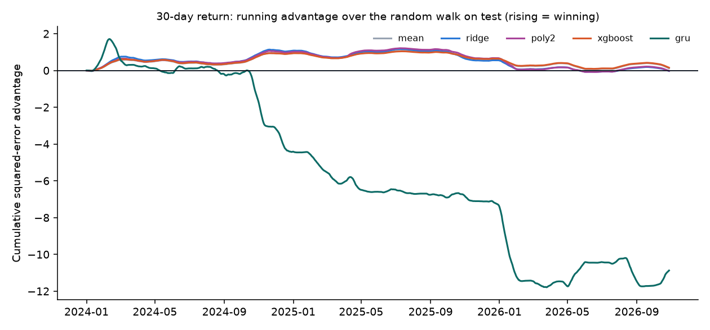

# Bitcoin model comparison: train, validate, test

Run: 2026-11-21 10:27 UTC · data collected 2026-11-21T09:59:34+00:00 · 47 of 48 series loaded · price base `btc` · runtime 20.3 min

**How to read this.** R²oos compares each model with the random-walk forecast (tomorrow's price = today's). 0 means no better than the random walk, negative means worse. The Diebold-Mariano p-value (DM p) tests whether a model beats the random walk by more than chance. A model should also beat the constant-drift forecast (the average past return, row `mean`). The overfit gap is in-sample R²oos minus test R²oos.

## Split

| Block | Period | Used for |
|---|---|---|
| Train | 2018-03-01 to 2022-12-31 | fitting |
| Validation | 2023-01-01 to 2023-12-31 | choosing hyperparameters and early stopping |
| Test | 2024-01-01 to latest | scored once, after refitting on train + validation |

## Next 1 day return (`r1`, 1 d)

Rows: train 1766, validation 365, test 1054 (2024-01-01 to 2026-11-19) · 189 features

| Model | Train R²oos | Val R²oos | Test R²oos | Test direction hit | Test DM p | Overfit gap | Half-years beating RW |
|---|---|---|---|---|---|---|---|
| zero | +0.00% | +0.00% | **+0.00%** | – | – | +0.00% | 0/6 |
| mean | +0.00% | +0.23% | **-0.01%** | 0.499 | 0.951 | +0.04% | 3/6 |
| ridge | +0.49% | -0.25% | **+0.04%** | 0.503 | 0.872 | +0.46% | 3/6 |
| poly2 | +4.85% | +0.70% | **+0.09%** | 0.491 | 0.893 | +4.69% | 2/6 |
| xgboost | +1.99% | +0.37% | **+0.08%** | 0.492 | 0.731 | +1.91% | 4/6 |
| ridge_fixed | +17.51% | -77.28% | **-133.24%** | 0.529 | 0.000 | +148.35% | 0/6 |
| poly2_fixed | +19.70% | -79.98% | **-30.87%** | 0.488 | 0.000 | +48.74% | 0/6 |
| xgb_fixed | +46.77% | -17.97% | **-3.55%** | 0.506 | 0.077 | +45.50% | 1/6 |
| gru | +2.44% | -1.46% | **-2.20%** | 0.505 | 0.039 | +5.81% | 0/6 |
| gru_fixed | +33.54% | -66.21% | **-48.80%** | 0.519 | 0.000 | +84.21% | 0/6 |

Ranking on test with overfitting flags:

- **poly2**: test R²oos +0.09%, DM p vs random walk 0.893, vs drift 0.877 · risk: loses to random walk in most half-years
- **xgboost**: test R²oos +0.08%, DM p vs random walk 0.731, vs drift 0.513 · no risk flags
- **ridge**: test R²oos +0.04%, DM p vs random walk 0.872, vs drift 0.684 · no risk flags
- **gru**: test R²oos -2.20%, DM p vs random walk 0.039, vs drift 0.028 · risk: large in-sample vs test gap, loses to random walk in most half-years, no better than the constant-drift forecast

**Verdict:** no model beats both the random walk and the constant drift significantly without an overfitting flag.

Overfitting probes (fixed settings, no validation brake): ridge_fixed in-sample +15.1% → test -133.2%; poly2_fixed in-sample +17.9% → test -30.9%; xgb_fixed in-sample +42.0% → test -3.5%; gru_fixed in-sample +35.4% → test -48.8%

GRU test R²oos by seed: -3.19%, -2.31%, -1.90%, -3.06%, -2.52%

## Next 7 day return (`r7`, 7 d)

Rows: train 1760, validation 365, test 1048 (2024-01-01 to 2026-11-13) · 189 features

| Model | Train R²oos | Val R²oos | Test R²oos | Test direction hit | Test DM p | Overfit gap | Half-years beating RW |
|---|---|---|---|---|---|---|---|
| zero | +0.00% | +0.00% | **+0.00%** | – | – | +0.00% | 0/6 |
| mean | +0.03% | +1.24% | **+0.04%** | 0.511 | 0.966 | +0.17% | 3/6 |
| ridge | +2.39% | -1.03% | **+0.20%** | 0.510 | 0.869 | +2.17% | 3/6 |
| poly2 | +0.31% | +1.23% | **+0.03%** | 0.511 | 0.979 | +0.48% | 3/6 |
| xgboost | +0.80% | +1.57% | **+0.34%** | 0.511 | 0.736 | +0.52% | 4/6 |
| ridge_fixed | +56.72% | -123.15% | **-491.65%** | 0.527 | 0.000 | +542.90% | 0/6 |
| poly2_fixed | +47.58% | -53.04% | **-96.19%** | 0.431 | 0.000 | +139.17% | 0/6 |
| xgb_fixed | +81.31% | -106.82% | **-18.81%** | 0.508 | 0.000 | +94.81% | 0/6 |
| gru | +10.30% | +2.18% | **-21.78%** | 0.500 | 0.000 | +45.18% | 0/6 |
| gru_fixed | +90.97% | -266.50% | **-139.96%** | 0.468 | 0.000 | +231.17% | 0/6 |

Ranking on test with overfitting flags:

- **xgboost**: test R²oos +0.34%, DM p vs random walk 0.736, vs drift 0.048 · no risk flags
- **ridge**: test R²oos +0.20%, DM p vs random walk 0.869, vs drift 0.745 · no risk flags
- **poly2**: test R²oos +0.03%, DM p vs random walk 0.979, vs drift 0.433 · risk: no better than the constant-drift forecast
- **gru**: test R²oos -21.78%, DM p vs random walk 0.000, vs drift 0.000 · risk: large in-sample vs test gap, validation result did not hold on test, loses to random walk in most half-years, no better than the constant-drift forecast

**Verdict:** no model beats both the random walk and the constant drift significantly without an overfitting flag.

Overfitting probes (fixed settings, no validation brake): ridge_fixed in-sample +51.2% → test -491.7%; poly2_fixed in-sample +43.0% → test -96.2%; xgb_fixed in-sample +76.0% → test -18.8%; gru_fixed in-sample +91.2% → test -140.0%

GRU test R²oos by seed: -23.72%, -24.02%, -20.43%, -25.71%, -21.90%

## Next 30 day return (`r30`, 30 d)

Rows: train 1737, validation 365, test 1025 (2024-01-01 to 2026-10-21) · 189 features

| Model | Train R²oos | Val R²oos | Test R²oos | Test direction hit | Test DM p | Overfit gap | Half-years beating RW |
|---|---|---|---|---|---|---|---|
| zero | +0.00% | +0.00% | **+0.00%** | – | – | +0.00% | 0/6 |
| mean | +0.24% | +6.66% | **+1.07%** | 0.548 | 0.814 | +0.04% | 4/6 |
| ridge | +7.37% | -2.63% | **+0.37%** | 0.548 | 0.944 | +6.87% | 4/6 |
| poly2 | +0.68% | +6.61% | **+1.06%** | 0.548 | 0.816 | +0.51% | 4/6 |
| xgboost | +17.21% | +9.89% | **-0.38%** | 0.546 | 0.934 | +17.64% | 3/6 |
| ridge_fixed | +86.13% | -1413.11% | **-496.56%** | 0.506 | 0.000 | +578.01% | 0/6 |
| poly2_fixed | +69.33% | -148.34% | **-72.69%** | 0.426 | 0.000 | +135.96% | 0/6 |
| xgb_fixed | +95.58% | -72.77% | **-28.76%** | 0.573 | 0.059 | +122.99% | 1/6 |
| gru | +23.17% | +9.76% | **-64.62%** | 0.612 | 0.021 | +142.33% | 1/6 |
| gru_fixed | +97.51% | -95.17% | **-103.28%** | 0.589 | 0.001 | +200.62% | 0/6 |

Ranking on test with overfitting flags:

- **poly2**: test R²oos +1.06%, DM p vs random walk 0.816, vs drift 0.774 · risk: validation result did not hold on test, no better than the constant-drift forecast
- **ridge**: test R²oos +0.37%, DM p vs random walk 0.944, vs drift 0.578 · risk: large in-sample vs test gap, no better than the constant-drift forecast
- **xgboost**: test R²oos -0.38%, DM p vs random walk 0.934, vs drift 0.306 · risk: large in-sample vs test gap, validation result did not hold on test, no better than the constant-drift forecast
- **gru**: test R²oos -64.62%, DM p vs random walk 0.021, vs drift 0.021 · risk: large in-sample vs test gap, validation result did not hold on test, loses to random walk in most half-years, unstable across seeds, no better than the constant-drift forecast

**Verdict:** no model beats both the random walk and the constant drift significantly without an overfitting flag.

Overfitting probes (fixed settings, no validation brake): ridge_fixed in-sample +81.4% → test -496.6%; poly2_fixed in-sample +63.3% → test -72.7%; xgb_fixed in-sample +94.2% → test -28.8%; gru_fixed in-sample +97.3% → test -103.3%

GRU test R²oos by seed: -82.36%, -68.11%, -98.61%, -85.27%, -78.18%

## Mean price over next 30 days (drives 50/100/200-day MA forecasts) (`m30`, 30 d)

Rows: train 1737, validation 365, test 1025 (2024-01-01 to 2026-10-21) · 189 features

| Model | Train R²oos | Val R²oos | Test R²oos | Test direction hit | Test DM p | Overfit gap | Half-years beating RW |
|---|---|---|---|---|---|---|---|
| zero | +0.00% | +0.00% | **+0.00%** | – | – | +0.00% | 0/6 |
| mean | +0.47% | +8.10% | **+1.29%** | 0.535 | 0.784 | +0.06% | 4/6 |
| ridge | +6.24% | +2.11% | **+0.63%** | 0.535 | 0.906 | +5.81% | 4/6 |
| poly2 | +0.60% | +8.03% | **+1.31%** | 0.535 | 0.780 | +0.18% | 4/6 |
| xgboost | +2.45% | +8.67% | **+1.81%** | 0.535 | 0.710 | +1.22% | 4/6 |
| ridge_fixed | +85.65% | -813.58% | **-344.98%** | 0.540 | 0.000 | +425.77% | 0/6 |
| poly2_fixed | +66.31% | -67.53% | **-94.83%** | 0.420 | 0.000 | +155.19% | 0/6 |
| xgb_fixed | +95.39% | -125.21% | **-49.79%** | 0.565 | 0.021 | +143.37% | 2/6 |
| gru | +18.73% | +12.95% | **-72.93%** | 0.530 | 0.003 | +144.01% | 1/6 |
| gru_fixed | +98.79% | -213.39% | **-158.94%** | 0.537 | 0.000 | +257.71% | 0/6 |

Ranking on test with overfitting flags:

- **xgboost**: test R²oos +1.81%, DM p vs random walk 0.710, vs drift 0.233 · risk: validation result did not hold on test
- **poly2**: test R²oos +1.31%, DM p vs random walk 0.780, vs drift 0.271 · risk: validation result did not hold on test
- **ridge**: test R²oos +0.63%, DM p vs random walk 0.906, vs drift 0.568 · risk: large in-sample vs test gap, no better than the constant-drift forecast
- **gru**: test R²oos -72.93%, DM p vs random walk 0.003, vs drift 0.003 · risk: large in-sample vs test gap, validation result did not hold on test, loses to random walk in most half-years, unstable across seeds, no better than the constant-drift forecast

**Verdict:** no model beats both the random walk and the constant drift significantly without an overfitting flag.

Overfitting probes (fixed settings, no validation brake): ridge_fixed in-sample +80.8% → test -345.0%; poly2_fixed in-sample +60.4% → test -94.8%; xgb_fixed in-sample +93.6% → test -49.8%; gru_fixed in-sample +98.8% → test -158.9%

GRU test R²oos by seed: -91.02%, -72.52%, -101.02%, -103.19%, -73.66%

## Walk-forward check (refit every 91 days, 2020 onwards)

Each quarter the models are re-tuned on the trailing year and refit on all earlier data, then forecast the next quarter. This tests the same models over about 25 different periods instead of one.

**Next 1 day return** · 25 folds, 2020-09-30 to 2026-11-19

| Model | R²oos | DM p vs random walk | DM p vs drift | 2020 | 2021 | 2022 | 2023 | 2024 | 2025 | 2026 |
|---|---|---|---|---|---|---|---|---|---|---|
| zero | **+0.00%** | – | – | +0.0% | +0.0% | +0.0% | +0.0% | +0.0% | +0.0% | +0.0% |
| mean | **-0.10%** | 0.403 | – | +0.0% | -0.0% | -0.5% | +0.3% | +0.3% | -0.2% | -0.4% |
| ridge | **-0.59%** | 0.181 | 0.239 | -0.2% | -0.8% | -0.8% | -1.4% | +0.3% | -0.6% | -0.3% |
| poly2 | **-0.60%** | 0.307 | 0.359 | +0.1% | +0.4% | -2.1% | -1.7% | -0.1% | -0.0% | -1.2% |
| xgboost | **-0.91%** | 0.238 | 0.293 | -2.4% | -0.6% | -0.8% | -0.8% | -0.6% | -1.4% | -1.7% |

**Next 7 day return** · 25 folds, 2020-09-30 to 2026-11-13

| Model | R²oos | DM p vs random walk | DM p vs drift | 2020 | 2021 | 2022 | 2023 | 2024 | 2025 | 2026 |
|---|---|---|---|---|---|---|---|---|---|---|
| zero | **+0.00%** | – | – | +0.0% | +0.0% | +0.0% | +0.0% | +0.0% | +0.0% | +0.0% |
| mean | **-0.71%** | 0.303 | – | +0.2% | -0.7% | -3.1% | +1.6% | +2.2% | -2.1% | -2.5% |
| ridge | **-2.22%** | 0.095 | 0.250 | +1.8% | -4.6% | -2.3% | -4.3% | +2.6% | -2.7% | -2.3% |
| poly2 | **-2.99%** | 0.260 | 0.358 | +2.6% | +1.9% | -5.9% | -19.1% | +0.7% | -1.9% | -3.2% |
| xgboost | **-8.28%** | 0.013 | 0.020 | +4.2% | -3.8% | -13.0% | -38.3% | +2.4% | -6.2% | -2.7% |

**Next 30 day return** · 25 folds, 2020-09-30 to 2026-10-21

| Model | R²oos | DM p vs random walk | DM p vs drift | 2020 | 2021 | 2022 | 2023 | 2024 | 2025 | 2026 |
|---|---|---|---|---|---|---|---|---|---|---|
| zero | **+0.00%** | – | – | +0.0% | +0.0% | +0.0% | +0.0% | +0.0% | +0.0% | +0.0% |
| mean | **-2.37%** | 0.432 | – | +2.7% | -5.2% | -13.7% | +7.8% | +9.6% | -12.2% | -7.2% |
| ridge | **-15.46%** | 0.036 | 0.065 | +3.6% | -20.2% | -2.8% | -104.2% | +10.2% | -19.6% | -6.6% |
| poly2 | **-14.18%** | 0.030 | 0.037 | +2.7% | -6.1% | -57.9% | -26.6% | +7.0% | -15.5% | -12.3% |
| xgboost | **-22.90%** | 0.009 | 0.006 | -3.9% | -60.8% | -14.2% | -6.1% | +4.6% | -55.3% | -7.9% |

**Mean price over next 30 days (drives 50/100/200-day MA forecasts)** · 25 folds, 2020-09-30 to 2026-10-21

| Model | R²oos | DM p vs random walk | DM p vs drift | 2020 | 2021 | 2022 | 2023 | 2024 | 2025 | 2026 |
|---|---|---|---|---|---|---|---|---|---|---|
| zero | **+0.00%** | – | – | +0.0% | +0.0% | +0.0% | +0.0% | +0.0% | +0.0% | +0.0% |
| mean | **-1.32%** | 0.646 | – | +4.6% | -3.4% | -14.1% | +8.7% | +8.8% | -10.5% | -6.5% |
| ridge | **-6.79%** | 0.193 | 0.223 | +5.9% | -16.8% | -0.5% | -28.8% | +8.9% | -15.4% | -6.0% |
| poly2 | **-8.91%** | 0.051 | 0.042 | +5.1% | -6.1% | -34.0% | -21.3% | +5.4% | -9.8% | -7.5% |
| xgboost | **-19.35%** | 0.028 | 0.020 | +2.2% | -40.3% | -7.6% | -45.7% | +3.9% | -45.3% | -8.4% |

## 50/100/200-day moving averages, 30 days ahead

Forecast = known part of the average + 30 predicted days (from the `m30` model). The naive forecast fills the 30 unknown days with today's price.

| Model | MA50 error | MA100 error | MA200 error | MA50 vs naive | MA100 vs naive | MA200 vs naive |
|---|---|---|---|---|---|---|
| gru | 4.87% | 2.49% | 1.29% | 1.339× | 1.332× | 1.320× |
| gru_fixed | 5.90% | 3.03% | 1.58% | 1.620× | 1.624× | 1.623× |
| mean | 3.69% | 1.89% | 0.99% | 1.013× | 1.010× | 1.011× |
| poly2 | 3.69% | 1.89% | 0.99% | 1.013× | 1.010× | 1.011× |
| poly2_fixed | 5.34% | 2.71% | 1.40% | 1.466× | 1.453× | 1.441× |
| ridge | 3.73% | 1.91% | 1.00% | 1.024× | 1.020× | 1.022× |
| ridge_fixed | 8.16% | 4.16% | 2.16% | 2.241× | 2.228× | 2.214× |
| xgb_fixed | 4.96% | 2.51% | 1.31% | 1.362× | 1.343× | 1.346× |
| xgboost | 3.68% | 1.88% | 0.98% | 1.012× | 1.009× | 1.010× |
| zero | 3.64% | 1.87% | 0.97% | 1.000× | 1.000× | 1.000× |

The naive forecast alone already explains MA50 96.2%, MA100 99.1%, MA200 99.8% of the variation in moving-average levels on test, so high R² on moving averages says nothing about skill.

## XGBoost: most used features (gain, final refit)

- `r1`: btc_ma_gap_20, fed_funds_chg_7, news_tone_conflict_lvl, btc_ma_gap_100, cm_exchange_supply_chg_7, ust10y_z365, ust10y_chg_30, gpr_acts_lvl, move_z365, ust10y_yahoo_z365, m2_chg_90, btc_rsi_14
- `r7`: fin_conditions_z365, btc_mom_90, btc_mom_365, epu_us_lvl, fin_conditions_lvl, fed_funds_z365
- `r30`: fin_conditions_z365, ust10y_lvl, ust10y_yahoo_lvl, fed_funds_lvl, move_z365, curve_10y2y_z365, btc_ma_gap_100, breakeven5y_z365, gold_ret_30, usd_broad_gap_200, stablecoin_supply_chg_90, fed_balance_sheet_chg_90
- `m30`: ust10y_yahoo_lvl, fin_conditions_z365, fed_funds_lvl, fed_funds_z365, m2_z365, epu_us_lvl

## Data sources

| Series | Source | Kind | Lag (days) | From | To | Status |
|---|---|---|---|---|---|---|
| breakeven5y | FRED (St. Louis Fed) | level | 1 | 2010-01-04 | 2026-11-20 | ok |
| btc | Yahoo Finance | price | 0 | 2014-09-17 | 2026-11-21 | ok |
| btc_volume | Yahoo Finance | count | 0 | 2014-09-17 | 2026-11-21 | ok |
| cm_active_addresses | Coin Metrics community API | count | 1 | 2013-01-01 | 2026-11-20 | ok |
| cm_exchange_inflow | Coin Metrics community API | count | 1 | 2013-01-01 | 2026-11-20 | ok |
| cm_exchange_outflow | Coin Metrics community API | count | 1 | 2013-01-01 | 2026-11-20 | ok |
| cm_exchange_supply | Coin Metrics community API | count | 1 | 2013-01-01 | 2026-11-20 | ok |
| cm_hashrate | Coin Metrics community API | count | 1 | 2013-01-01 | 2026-11-20 | ok |
| cm_issuance | Coin Metrics community API | count | 1 | 2013-01-01 | 2026-11-20 | ok |
| cm_mvrv | Coin Metrics community API | level | 1 | 2013-01-01 | 2026-11-20 | ok |
| cm_price | Coin Metrics community API | price | 1 | 2013-01-01 | 2026-11-20 | ok |
| cm_tx_count | Coin Metrics community API | count | 1 | 2013-01-01 | 2026-11-20 | ok |
| coin | Yahoo Finance | price | 0 | 2021-04-14 | 2026-11-20 | ok |
| curve_10y2y | FRED (St. Louis Fed) | level | 1 | 2010-01-04 | 2026-11-20 | ok |
| dxy | Yahoo Finance | price | 0 | 2013-01-02 | 2026-11-20 | ok |
| emu_us | FRED (St. Louis Fed) | level | 1 | 2010-01-01 | 2026-11-19 | ok |
| epu_us | FRED (St. Louis Fed) | level | 1 | 2010-01-01 | 2026-11-19 | ok |
| eth | Yahoo Finance | price | 0 | 2017-11-09 | 2026-11-21 | ok |
| fear_greed | alternative.me | level | 0 | 2018-02-01 | 2026-11-21 | ok |
| fed_balance_sheet | FRED (St. Louis Fed) | count | 2 | 2010-01-06 | 2026-11-18 | ok |
| fed_funds | FRED (St. Louis Fed) | level | 1 | 2010-01-01 | 2026-11-19 | ok |
| fin_conditions | FRED (St. Louis Fed) | level | 7 | 2010-01-01 | 2026-11-13 | ok |
| funding_rate | Binance or BitMEX | | | | | failed: RuntimeError: binance: Binance HTTP 451; bitmex: BitMEX HTTP 403 |
| gold | Yahoo Finance | price | 0 | 2013-01-02 | 2026-11-20 | ok |
| gpr | Caldara & Iacoviello GPR | level | 1 | 2010-01-01 | 2026-11-16 | ok |
| gpr_acts | Caldara & Iacoviello GPR | level | 1 | 2010-01-01 | 2026-11-16 | ok |
| gpr_threats | Caldara & Iacoviello GPR | level | 1 | 2010-01-01 | 2026-11-16 | ok |
| hy_spread | FRED (St. Louis Fed) | level | 1 | 2023-11-21 | 2026-11-19 | ok |
| m2 | FRED (St. Louis Fed) | count | 60 | 2010-01-01 | 2026-09-01 | ok |
| move | Yahoo Finance | level | 0 | 2013-01-02 | 2026-11-20 | ok |
| mstr | Yahoo Finance | price | 0 | 2013-01-02 | 2026-11-20 | ok |
| nasdaq | Yahoo Finance | price | 0 | 2013-01-02 | 2026-11-20 | ok |
| news_tone_bitcoin | GDELT 2.0 DOC API | level | 1 | 2017-01-01 | 2026-11-21 | ok |
| news_tone_conflict | GDELT 2.0 DOC API | level | 1 | 2017-01-01 | 2026-11-21 | ok |
| news_tone_macro | GDELT 2.0 DOC API | level | 1 | 2017-01-01 | 2026-11-21 | ok |
| news_volume_bitcoin | GDELT 2.0 DOC API | count | 1 | 2017-01-01 | 2026-11-21 | ok |
| oil | Yahoo Finance | price | 0 | 2013-01-02 | 2026-11-20 | ok |
| reverse_repo | FRED (St. Louis Fed) | count | 1 | 2010-08-12 | 2026-11-20 | ok |
| sp500 | Yahoo Finance | price | 0 | 2013-01-02 | 2026-11-20 | ok |
| stablecoin_supply | DefiLlama | count | 1 | 2017-11-29 | 2026-11-21 | ok |
| treasury_account | FRED (St. Louis Fed) | count | 2 | 2010-01-06 | 2026-11-18 | ok |
| usd_broad | FRED (St. Louis Fed) | price | 1 | 2010-01-04 | 2026-11-13 | ok |
| ust10y | FRED (St. Louis Fed) | level | 1 | 2010-01-04 | 2026-11-19 | ok |
| ust10y_yahoo | Yahoo Finance | level | 0 | 2013-01-02 | 2026-11-20 | ok |
| ust2y | FRED (St. Louis Fed) | level | 1 | 2010-01-04 | 2026-11-19 | ok |
| vix | Yahoo Finance | level | 0 | 2013-01-02 | 2026-11-20 | ok |
| wiki_bitcoin | Wikimedia pageviews | count | 1 | 2015-07-01 | 2026-11-20 | ok |
| wiki_crypto | Wikimedia pageviews | count | 1 | 2015-07-01 | 2026-11-20 | ok |

Lag is the number of days a value is held back before the model may use it, so that only data that was public at the time enters each prediction.
