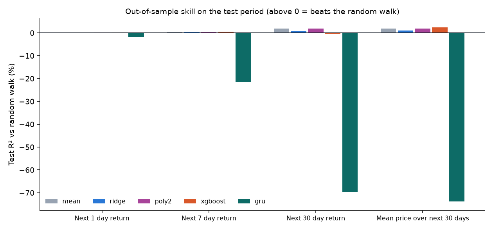
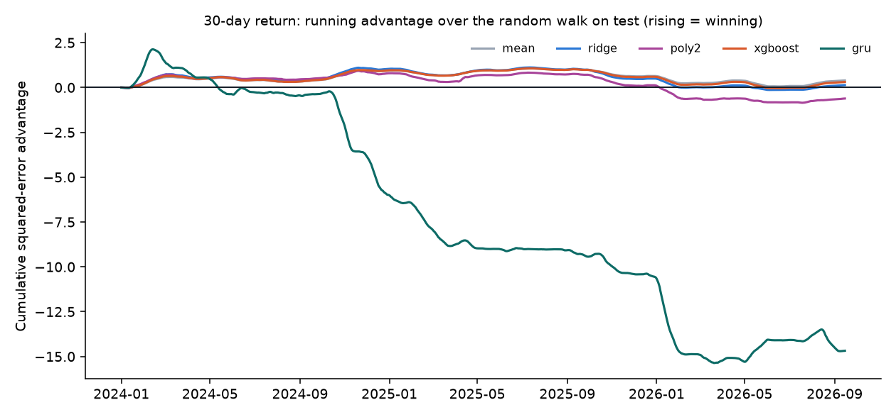

# Bitcoin model comparison: train, validate, test

Run: 2026-10-24 07:55 UTC · data collected 2026-10-24T07:35:10+00:00 · 46 of 48 series loaded · price base `btc` · runtime 13.9 min

**How to read this.** R²oos compares each model with the random-walk forecast (tomorrow's price = today's). 0 means no better than the random walk, negative means worse. The Diebold-Mariano p-value (DM p) tests whether a model beats the random walk by more than chance. A model should also beat the constant-drift forecast (the average past return, row `mean`). The overfit gap is in-sample R²oos minus test R²oos.

## Split

| Block | Period | Used for |
|---|---|---|
| Train | 2018-03-01 to 2022-12-31 | fitting |
| Validation | 2023-01-01 to 2023-12-31 | choosing hyperparameters and early stopping |
| Test | 2024-01-01 to latest | scored once, after refitting on train + validation |

## Next 1 day return (`r1`, 1 d)

Rows: train 1766, validation 365, test 1026 (2024-01-01 to 2026-10-22) · 185 features

| Model | Train R²oos | Val R²oos | Test R²oos | Test direction hit | Test DM p | Overfit gap | Half-years beating RW |
|---|---|---|---|---|---|---|---|
| zero | +0.00% | +0.00% | **+0.00%** | – | – | +0.00% | 0/6 |
| mean | +0.00% | +0.23% | **+0.06%** | 0.502 | 0.712 | -0.03% | 4/6 |
| ridge | +0.49% | -0.26% | **+0.05%** | 0.503 | 0.822 | +0.43% | 4/6 |
| poly2 | +0.08% | +0.23% | **+0.07%** | 0.502 | 0.650 | +0.05% | 4/6 |
| xgboost | +1.56% | +0.32% | **+0.11%** | 0.500 | 0.626 | +1.45% | 4/6 |
| ridge_fixed | +17.20% | -85.95% | **-124.70%** | 0.538 | 0.000 | +139.52% | 0/6 |
| poly2_fixed | +20.30% | -64.31% | **-28.27%** | 0.489 | 0.000 | +46.54% | 0/6 |
| xgb_fixed | +47.01% | -18.74% | **-2.09%** | 0.510 | 0.293 | +43.94% | 2/6 |
| gru | +2.90% | -3.39% | **-2.20%** | 0.512 | 0.060 | +5.90% | 0/6 |
| gru_fixed | +35.39% | -104.68% | **-42.24%** | 0.540 | 0.000 | +78.63% | 0/6 |

Ranking on test with overfitting flags:

- **xgboost**: test R²oos +0.11%, DM p vs random walk 0.626, vs drift 0.698 · no risk flags
- **poly2**: test R²oos +0.07%, DM p vs random walk 0.650, vs drift 0.149 · no risk flags
- **ridge**: test R²oos +0.05%, DM p vs random walk 0.822, vs drift 0.953 · risk: no better than the constant-drift forecast
- **gru**: test R²oos -2.20%, DM p vs random walk 0.060, vs drift 0.040 · risk: large in-sample vs test gap, loses to random walk in most half-years, no better than the constant-drift forecast

**Verdict:** no model beats both the random walk and the constant drift significantly without an overfitting flag.

Overfitting probes (fixed settings, no validation brake): ridge_fixed in-sample +14.8% → test -124.7%; poly2_fixed in-sample +18.3% → test -28.3%; xgb_fixed in-sample +41.8% → test -2.1%; gru_fixed in-sample +36.4% → test -42.2%

GRU test R²oos by seed: -3.80%, -1.91%, -1.93%, -2.69%, -2.75%

## Next 7 day return (`r7`, 7 d)

Rows: train 1760, validation 365, test 1020 (2024-01-01 to 2026-10-16) · 185 features

| Model | Train R²oos | Val R²oos | Test R²oos | Test direction hit | Test DM p | Overfit gap | Half-years beating RW |
|---|---|---|---|---|---|---|---|
| zero | +0.00% | +0.00% | **+0.00%** | – | – | +0.00% | 0/6 |
| mean | +0.03% | +1.24% | **+0.46%** | 0.525 | 0.643 | -0.24% | 4/6 |
| ridge | +2.36% | -1.06% | **+0.43%** | 0.523 | 0.735 | +1.90% | 4/6 |
| poly2 | +0.05% | +1.21% | **+0.47%** | 0.525 | 0.634 | -0.23% | 4/6 |
| xgboost | +0.44% | +1.21% | **+0.35%** | 0.525 | 0.748 | +0.22% | 4/6 |
| ridge_fixed | +55.97% | -128.22% | **-455.60%** | 0.492 | 0.000 | +505.77% | 0/6 |
| poly2_fixed | +46.82% | -70.66% | **-92.15%** | 0.456 | 0.000 | +135.03% | 0/6 |
| xgb_fixed | +80.72% | -96.02% | **-22.51%** | 0.529 | 0.000 | +98.52% | 1/6 |
| gru | +8.88% | +2.85% | **-23.12%** | 0.508 | 0.000 | +45.40% | 0/6 |
| gru_fixed | +91.31% | -235.29% | **-145.65%** | 0.515 | 0.000 | +236.83% | 0/6 |

Ranking on test with overfitting flags:

- **poly2**: test R²oos +0.47%, DM p vs random walk 0.634, vs drift 0.129 · no risk flags
- **ridge**: test R²oos +0.43%, DM p vs random walk 0.735, vs drift 0.962 · risk: no better than the constant-drift forecast
- **xgboost**: test R²oos +0.35%, DM p vs random walk 0.748, vs drift 0.283 · risk: no better than the constant-drift forecast
- **gru**: test R²oos -23.12%, DM p vs random walk 0.000, vs drift 0.000 · risk: large in-sample vs test gap, validation result did not hold on test, loses to random walk in most half-years, no better than the constant-drift forecast

**Verdict:** no model beats both the random walk and the constant drift significantly without an overfitting flag.

Overfitting probes (fixed settings, no validation brake): ridge_fixed in-sample +50.2% → test -455.6%; poly2_fixed in-sample +42.9% → test -92.1%; xgb_fixed in-sample +76.0% → test -22.5%; gru_fixed in-sample +91.2% → test -145.6%

GRU test R²oos by seed: -24.44%, -27.56%, -24.05%, -23.97%, -23.09%

## Next 30 day return (`r30`, 30 d)

Rows: train 1737, validation 365, test 997 (2024-01-01 to 2026-09-23) · 185 features

| Model | Train R²oos | Val R²oos | Test R²oos | Test direction hit | Test DM p | Overfit gap | Half-years beating RW |
|---|---|---|---|---|---|---|---|
| zero | +0.00% | +0.00% | **+0.00%** | – | – | +0.00% | 0/6 |
| mean | +0.24% | +6.66% | **+2.03%** | 0.564 | 0.662 | -0.92% | 4/6 |
| ridge | +7.27% | -2.54% | **+0.89%** | 0.564 | 0.870 | +6.26% | 4/6 |
| poly2 | +0.65% | +6.65% | **+2.02%** | 0.564 | 0.665 | -0.47% | 4/6 |
| xgboost | +2.32% | +7.76% | **+1.56%** | 0.564 | 0.755 | +1.51% | 4/6 |
| ridge_fixed | +85.95% | -1446.33% | **-556.78%** | 0.527 | 0.000 | +637.91% | 0/6 |
| poly2_fixed | +69.15% | -146.11% | **-69.86%** | 0.448 | 0.000 | +132.26% | 0/6 |
| xgb_fixed | +95.61% | -138.21% | **-36.01%** | 0.577 | 0.024 | +130.23% | 0/6 |
| gru | +26.51% | +7.84% | **-63.59%** | 0.529 | 0.008 | +139.01% | 0/6 |
| gru_fixed | +97.37% | -75.78% | **-96.12%** | 0.514 | 0.000 | +193.58% | 0/6 |

Ranking on test with overfitting flags:

- **poly2**: test R²oos +2.02%, DM p vs random walk 0.665, vs drift 0.746 · risk: no better than the constant-drift forecast
- **xgboost**: test R²oos +1.56%, DM p vs random walk 0.755, vs drift 0.310 · risk: validation result did not hold on test, no better than the constant-drift forecast
- **ridge**: test R²oos +0.89%, DM p vs random walk 0.870, vs drift 0.360 · risk: large in-sample vs test gap, no better than the constant-drift forecast
- **gru**: test R²oos -63.59%, DM p vs random walk 0.008, vs drift 0.007 · risk: large in-sample vs test gap, validation result did not hold on test, loses to random walk in most half-years, unstable across seeds, no better than the constant-drift forecast

**Verdict:** no model beats both the random walk and the constant drift significantly without an overfitting flag.

Overfitting probes (fixed settings, no validation brake): ridge_fixed in-sample +81.1% → test -556.8%; poly2_fixed in-sample +62.4% → test -69.9%; xgb_fixed in-sample +94.2% → test -36.0%; gru_fixed in-sample +97.5% → test -96.1%

GRU test R²oos by seed: -82.35%, -79.76%, -88.46%, -83.44%, -64.10%

## Mean price over next 30 days (drives 50/100/200-day MA forecasts) (`m30`, 30 d)

Rows: train 1737, validation 365, test 997 (2024-01-01 to 2026-09-23) · 185 features

| Model | Train R²oos | Val R²oos | Test R²oos | Test direction hit | Test DM p | Overfit gap | Half-years beating RW |
|---|---|---|---|---|---|---|---|
| zero | +0.00% | +0.00% | **+0.00%** | – | – | +0.00% | 0/6 |
| mean | +0.47% | +8.10% | **+1.93%** | 0.550 | 0.684 | -0.58% | 4/6 |
| ridge | +6.14% | +2.10% | **+1.01%** | 0.550 | 0.852 | +5.34% | 4/6 |
| poly2 | +0.86% | +8.03% | **+1.91%** | 0.550 | 0.688 | -0.16% | 4/6 |
| xgboost | +11.24% | +10.38% | **+2.31%** | 0.550 | 0.732 | +8.84% | 4/6 |
| ridge_fixed | +85.31% | -878.16% | **-304.00%** | 0.531 | 0.000 | +384.46% | 0/6 |
| poly2_fixed | +66.42% | -90.32% | **-84.85%** | 0.431 | 0.000 | +144.64% | 0/6 |
| xgb_fixed | +95.30% | -127.44% | **-44.84%** | 0.538 | 0.028 | +138.22% | 2/6 |
| gru | +23.73% | +12.35% | **-69.95%** | 0.502 | 0.002 | +136.96% | 1/6 |
| gru_fixed | +98.66% | -184.51% | **-169.36%** | 0.507 | 0.000 | +268.16% | 0/6 |

Ranking on test with overfitting flags:

- **xgboost**: test R²oos +2.31%, DM p vs random walk 0.732, vs drift 0.879 · risk: large in-sample vs test gap, validation result did not hold on test
- **poly2**: test R²oos +1.91%, DM p vs random walk 0.688, vs drift 0.482 · risk: validation result did not hold on test, no better than the constant-drift forecast
- **ridge**: test R²oos +1.01%, DM p vs random walk 0.852, vs drift 0.415 · risk: large in-sample vs test gap, no better than the constant-drift forecast
- **gru**: test R²oos -69.95%, DM p vs random walk 0.002, vs drift 0.001 · risk: large in-sample vs test gap, validation result did not hold on test, loses to random walk in most half-years, unstable across seeds, no better than the constant-drift forecast

**Verdict:** no model beats both the random walk and the constant drift significantly without an overfitting flag.

Overfitting probes (fixed settings, no validation brake): ridge_fixed in-sample +80.5% → test -304.0%; poly2_fixed in-sample +59.8% → test -84.9%; xgb_fixed in-sample +93.4% → test -44.8%; gru_fixed in-sample +98.8% → test -169.4%

GRU test R²oos by seed: -66.25%, -96.17%, -87.89%, -94.08%, -71.67%

## Walk-forward check (refit every 91 days, 2020 onwards)

Each quarter the models are re-tuned on the trailing year and refit on all earlier data, then forecast the next quarter. This tests the same models over about 25 different periods instead of one.

**Next 1 day return** · 25 folds, 2020-09-30 to 2026-10-22

| Model | R²oos | DM p vs random walk | DM p vs drift | 2020 | 2021 | 2022 | 2023 | 2024 | 2025 | 2026 |
|---|---|---|---|---|---|---|---|---|---|---|
| zero | **+0.00%** | – | – | +0.0% | +0.0% | +0.0% | +0.0% | +0.0% | +0.0% | +0.0% |
| mean | **-0.08%** | 0.512 | – | +0.0% | -0.0% | -0.5% | +0.3% | +0.3% | -0.2% | -0.2% |
| ridge | **-1.18%** | 0.032 | 0.041 | +0.2% | -2.0% | -1.8% | -1.5% | +0.3% | -0.6% | -0.3% |
| poly2 | **-0.34%** | 0.663 | 0.726 | +0.2% | +0.4% | -1.5% | -1.2% | +0.0% | +0.1% | -0.7% |
| xgboost | **-0.30%** | 0.552 | 0.644 | +1.6% | -0.3% | -0.7% | -0.8% | -0.2% | +0.0% | -0.3% |

**Next 7 day return** · 25 folds, 2020-09-30 to 2026-10-16

| Model | R²oos | DM p vs random walk | DM p vs drift | 2020 | 2021 | 2022 | 2023 | 2024 | 2025 | 2026 |
|---|---|---|---|---|---|---|---|---|---|---|
| zero | **+0.00%** | – | – | +0.0% | +0.0% | +0.0% | +0.0% | +0.0% | +0.0% | +0.0% |
| mean | **-0.60%** | 0.387 | – | +0.2% | -0.7% | -3.1% | +1.6% | +2.2% | -2.1% | -1.5% |
| ridge | **-2.17%** | 0.106 | 0.240 | +1.8% | -4.4% | -2.4% | -4.7% | +2.6% | -2.1% | -2.1% |
| poly2 | **-3.24%** | 0.127 | 0.187 | +5.3% | +1.1% | -5.4% | -17.1% | -3.8% | -1.6% | -3.1% |
| xgboost | **-8.58%** | 0.022 | 0.030 | +0.2% | -1.2% | -12.3% | -47.2% | +4.1% | -7.2% | -1.4% |

**Next 30 day return** · 25 folds, 2020-09-30 to 2026-09-23

| Model | R²oos | DM p vs random walk | DM p vs drift | 2020 | 2021 | 2022 | 2023 | 2024 | 2025 | 2026 |
|---|---|---|---|---|---|---|---|---|---|---|
| zero | **+0.00%** | – | – | +0.0% | +0.0% | +0.0% | +0.0% | +0.0% | +0.0% | +0.0% |
| mean | **-2.16%** | 0.479 | – | +2.7% | -5.2% | -13.7% | +7.8% | +9.6% | -12.2% | -5.2% |
| ridge | **-15.65%** | 0.033 | 0.054 | +3.7% | -16.8% | -13.2% | -97.9% | +10.2% | -19.5% | -5.8% |
| poly2 | **-17.49%** | 0.022 | 0.017 | +2.4% | -15.3% | -58.3% | -29.3% | +5.9% | -16.7% | -15.0% |
| xgboost | **-26.58%** | 0.008 | 0.005 | -7.2% | -69.2% | -10.7% | -26.5% | +6.2% | -49.0% | -5.6% |

**Mean price over next 30 days (drives 50/100/200-day MA forecasts)** · 25 folds, 2020-09-30 to 2026-09-23

| Model | R²oos | DM p vs random walk | DM p vs drift | 2020 | 2021 | 2022 | 2023 | 2024 | 2025 | 2026 |
|---|---|---|---|---|---|---|---|---|---|---|
| zero | **+0.00%** | – | – | +0.0% | +0.0% | +0.0% | +0.0% | +0.0% | +0.0% | +0.0% |
| mean | **-1.17%** | 0.685 | – | +4.6% | -3.4% | -14.1% | +8.7% | +8.8% | -10.5% | -4.9% |
| ridge | **-6.38%** | 0.187 | 0.165 | +5.8% | -14.5% | -2.4% | -28.5% | +8.9% | -15.3% | -5.1% |
| poly2 | **-11.10%** | 0.057 | 0.029 | +4.9% | -14.7% | -30.8% | -22.7% | +2.5% | -10.2% | -4.8% |
| xgboost | **-18.13%** | 0.041 | 0.028 | +2.0% | -35.8% | -7.6% | -58.8% | +8.5% | -35.4% | -4.7% |

## 50/100/200-day moving averages, 30 days ahead

Forecast = known part of the average + 30 predicted days (from the `m30` model). The naive forecast fills the 30 unknown days with today's price.

| Model | MA50 error | MA100 error | MA200 error | MA50 vs naive | MA100 vs naive | MA200 vs naive |
|---|---|---|---|---|---|---|
| gru | 4.94% | 2.54% | 1.33% | 1.347× | 1.347× | 1.352× |
| gru_fixed | 6.31% | 3.27% | 1.72% | 1.721× | 1.736× | 1.753× |
| mean | 3.69% | 1.89% | 0.99% | 1.007× | 1.003× | 1.004× |
| poly2 | 3.69% | 1.89% | 0.99% | 1.007× | 1.003× | 1.004× |
| poly2_fixed | 5.28% | 2.69% | 1.39% | 1.441× | 1.427× | 1.418× |
| ridge | 3.74% | 1.91% | 1.00% | 1.019× | 1.015× | 1.017× |
| ridge_fixed | 7.95% | 4.05% | 2.10% | 2.169× | 2.152× | 2.138× |
| xgb_fixed | 4.91% | 2.49% | 1.30% | 1.339× | 1.321× | 1.320× |
| xgboost | 3.73% | 1.91% | 1.00% | 1.018× | 1.013× | 1.015× |
| zero | 3.67% | 1.88% | 0.98% | 1.000× | 1.000× | 1.000× |

The naive forecast alone already explains MA50 96.2%, MA100 99.1%, MA200 99.8% of the variation in moving-average levels on test, so high R² on moving averages says nothing about skill.

## XGBoost: most used features (gain, final refit)

- `r1`: dxy_gap_200, cm_exchange_supply_z365, cm_exchange_supply_chg_7, fin_conditions_chg_7, reverse_repo_chg_30, cm_tx_count_z365, oil_gap_200, wiki_crypto_z365, btc_ma_gap_50, cm_issuance_chg_90, news_tone_bitcoin_chg_30, btc_mom_60
- `r7`: fin_conditions_z365, btc_mom_90, curve_10y2y_lvl
- `r30`: ust10y_yahoo_lvl, fed_funds_lvl, btc_vol_90, mstr_gap_200, btc_mom_60, btc_ma_gap_200, btc_mom_180, fin_conditions_z365, dxy_gap_200, fed_funds_z365, cm_mvrv_lvl, stablecoin_supply_chg_90
- `m30`: fin_conditions_z365, fed_balance_sheet_chg_90, btc_vol_90, btc_ma_gap_100, ust10y_yahoo_lvl, breakeven5y_lvl, curve_10y2y_z365, fed_funds_z365, fin_conditions_lvl, fed_funds_lvl, reverse_repo_z365, move_z365

## Data sources

| Series | Source | Kind | Lag (days) | From | To | Status |
|---|---|---|---|---|---|---|
| breakeven5y | FRED (St. Louis Fed) | level | 1 | 2010-01-04 | 2026-10-23 | ok |
| btc | Yahoo Finance | price | 0 | 2014-09-17 | 2026-10-24 | ok |
| btc_volume | Yahoo Finance | count | 0 | 2014-09-17 | 2026-10-24 | ok |
| cm_active_addresses | Coin Metrics community API | count | 1 | 2013-01-01 | 2026-10-23 | ok |
| cm_exchange_inflow | Coin Metrics community API | count | 1 | 2013-01-01 | 2026-10-23 | ok |
| cm_exchange_outflow | Coin Metrics community API | count | 1 | 2013-01-01 | 2026-10-23 | ok |
| cm_exchange_supply | Coin Metrics community API | count | 1 | 2013-01-01 | 2026-10-23 | ok |
| cm_hashrate | Coin Metrics community API | count | 1 | 2013-01-01 | 2026-10-23 | ok |
| cm_issuance | Coin Metrics community API | count | 1 | 2013-01-01 | 2026-10-23 | ok |
| cm_mvrv | Coin Metrics community API | level | 1 | 2013-01-01 | 2026-10-23 | ok |
| cm_price | Coin Metrics community API | price | 1 | 2013-01-01 | 2026-10-23 | ok |
| cm_tx_count | Coin Metrics community API | count | 1 | 2013-01-01 | 2026-10-23 | ok |
| coin | Yahoo Finance | price | 0 | 2021-04-14 | 2026-10-23 | ok |
| curve_10y2y | FRED (St. Louis Fed) | level | 1 | 2010-01-04 | 2026-10-23 | ok |
| dxy | Yahoo Finance | price | 0 | 2013-01-02 | 2026-10-23 | ok |
| emu_us | FRED (St. Louis Fed) | level | 1 | 2010-01-01 | 2026-10-22 | ok |
| epu_us | FRED (St. Louis Fed) | level | 1 | 2010-01-01 | 2026-10-22 | ok |
| eth | Yahoo Finance | price | 0 | 2017-11-09 | 2026-10-24 | ok |
| fear_greed | alternative.me | level | 0 | 2018-02-01 | 2026-10-24 | ok |
| fed_balance_sheet | FRED (St. Louis Fed) | count | 2 | 2010-01-06 | 2026-10-21 | ok |
| fed_funds | FRED (St. Louis Fed) | level | 1 | 2010-01-01 | 2026-10-22 | ok |
| fin_conditions | FRED (St. Louis Fed) | level | 7 | 2010-01-01 | 2026-10-16 | ok |
| funding_rate | Binance or BitMEX | | | | | failed: RuntimeError: binance: Binance HTTP 451; bitmex: BitMEX HTTP 403 |
| gold | Yahoo Finance | price | 0 | 2013-01-02 | 2026-10-23 | ok |
| gpr | Caldara & Iacoviello GPR | level | 1 | 2010-01-01 | 2026-10-19 | ok |
| gpr_acts | Caldara & Iacoviello GPR | level | 1 | 2010-01-01 | 2026-10-19 | ok |
| gpr_threats | Caldara & Iacoviello GPR | level | 1 | 2010-01-01 | 2026-10-19 | ok |
| hy_spread | FRED (St. Louis Fed) | level | 1 | 2023-10-24 | 2026-10-22 | ok |
| m2 | FRED (St. Louis Fed) | count | 60 | 2010-01-01 | 2026-08-01 | ok |
| move | Yahoo Finance | level | 0 | 2013-01-02 | 2026-10-23 | ok |
| mstr | Yahoo Finance | price | 0 | 2013-01-02 | 2026-10-23 | ok |
| nasdaq | Yahoo Finance | price | 0 | 2013-01-02 | 2026-10-23 | ok |
| news_tone_bitcoin | GDELT 2.0 DOC API | level | 1 | 2017-01-01 | 2026-10-24 | ok |
| news_tone_conflict | GDELT 2.0 DOC API | level | 1 | 2017-01-01 | 2026-10-24 | ok |
| news_tone_macro | GDELT 2.0 DOC API | level | 1 | 2017-01-01 | 2026-10-24 | ok |
| news_volume_bitcoin | GDELT | | | | | failed: RuntimeError: GDELT rate limit persisted |
| oil | Yahoo Finance | price | 0 | 2013-01-02 | 2026-10-23 | ok |
| reverse_repo | FRED (St. Louis Fed) | count | 1 | 2010-08-12 | 2026-10-23 | ok |
| sp500 | Yahoo Finance | price | 0 | 2013-01-02 | 2026-10-23 | ok |
| stablecoin_supply | DefiLlama | count | 1 | 2017-11-29 | 2026-10-24 | ok |
| treasury_account | FRED (St. Louis Fed) | count | 2 | 2010-01-06 | 2026-10-21 | ok |
| usd_broad | FRED (St. Louis Fed) | price | 1 | 2010-01-04 | 2026-10-16 | ok |
| ust10y | FRED (St. Louis Fed) | level | 1 | 2010-01-04 | 2026-10-22 | ok |
| ust10y_yahoo | Yahoo Finance | level | 0 | 2013-01-02 | 2026-10-23 | ok |
| ust2y | FRED (St. Louis Fed) | level | 1 | 2010-01-04 | 2026-10-22 | ok |
| vix | Yahoo Finance | level | 0 | 2013-01-02 | 2026-10-23 | ok |
| wiki_bitcoin | Wikimedia pageviews | count | 1 | 2015-07-01 | 2026-10-22 | ok |
| wiki_crypto | Wikimedia pageviews | count | 1 | 2015-07-01 | 2026-10-23 | ok |

Lag is the number of days a value is held back before the model may use it, so that only data that was public at the time enters each prediction.
