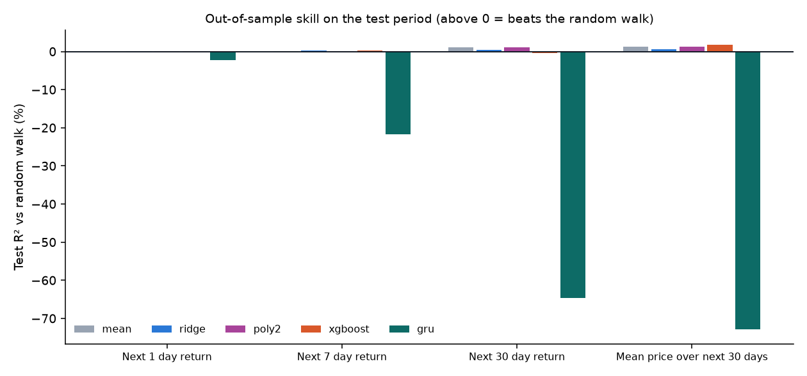

# Bitcoin model comparison: train, validate, test

Run: 2026-11-28 11:12 UTC · data collected 2026-11-28T10:51:04+00:00 · 44 of 48 series loaded · price base `btc` · runtime 13.2 min

**How to read this.** R²oos compares each model with the random-walk forecast (tomorrow's price = today's). 0 means no better than the random walk, negative means worse. The Diebold-Mariano p-value (DM p) tests whether a model beats the random walk by more than chance. A model should also beat the constant-drift forecast (the average past return, row `mean`). The overfit gap is in-sample R²oos minus test R²oos.

## Split

| Block | Period | Used for |
|---|---|---|
| Train | 2018-03-01 to 2022-12-31 | fitting |
| Validation | 2023-01-01 to 2023-12-31 | choosing hyperparameters and early stopping |
| Test | 2024-01-01 to latest | scored once, after refitting on train + validation |

## Next 1 day return (`r1`, 1 d)

Rows: train 1766, validation 365, test 1061 (2024-01-01 to 2026-11-26) · 177 features

| Model | Train R²oos | Val R²oos | Test R²oos | Test direction hit | Test DM p | Overfit gap | Half-years beating RW |
|---|---|---|---|---|---|---|---|
| zero | +0.00% | +0.00% | **+0.00%** | – | – | +0.00% | 0/6 |
| mean | +0.00% | +0.23% | **-0.01%** | 0.500 | 0.967 | +0.04% | 3/6 |
| ridge | +0.47% | -0.24% | **+0.03%** | 0.505 | 0.877 | +0.44% | 3/6 |
| poly2 | +0.01% | +0.22% | **-0.00%** | 0.500 | 0.975 | +0.04% | 3/6 |
| xgboost | +0.34% | +0.24% | **+0.00%** | 0.500 | 0.973 | +0.29% | 4/6 |
| ridge_fixed | +16.76% | -65.15% | **-212.94%** | 0.520 | 0.000 | +227.03% | 0/6 |
| poly2_fixed | +19.19% | -66.97% | **-22.08%** | 0.506 | 0.000 | +38.99% | 0/6 |
| xgb_fixed | +45.72% | -16.06% | **-3.25%** | 0.500 | 0.079 | +44.25% | 0/6 |
| gru | +3.09% | +0.10% | **-3.51%** | 0.504 | 0.005 | +6.90% | 0/6 |
| gru_fixed | +34.19% | -43.11% | **-58.50%** | 0.504 | 0.000 | +94.56% | 0/6 |

Ranking on test with overfitting flags:

- **ridge**: test R²oos +0.03%, DM p vs random walk 0.877, vs drift 0.713 · no risk flags
- **xgboost**: test R²oos +0.00%, DM p vs random walk 0.973, vs drift 0.826 · no risk flags
- **poly2**: test R²oos -0.00%, DM p vs random walk 0.975, vs drift 0.148 · no risk flags
- **gru**: test R²oos -3.51%, DM p vs random walk 0.005, vs drift 0.002 · risk: large in-sample vs test gap, loses to random walk in most half-years, no better than the constant-drift forecast

**Verdict:** no model beats both the random walk and the constant drift significantly without an overfitting flag.

Overfitting probes (fixed settings, no validation brake): ridge_fixed in-sample +14.1% → test -212.9%; poly2_fixed in-sample +16.9% → test -22.1%; xgb_fixed in-sample +41.0% → test -3.3%; gru_fixed in-sample +36.1% → test -58.5%

GRU test R²oos by seed: -4.53%, -4.28%, -3.43%, -3.29%, -4.01%

## Next 7 day return (`r7`, 7 d)

Rows: train 1760, validation 365, test 1055 (2024-01-01 to 2026-11-20) · 177 features

| Model | Train R²oos | Val R²oos | Test R²oos | Test direction hit | Test DM p | Overfit gap | Half-years beating RW |
|---|---|---|---|---|---|---|---|
| zero | +0.00% | +0.00% | **+0.00%** | – | – | +0.00% | 0/6 |
| mean | +0.03% | +1.24% | **-0.03%** | 0.509 | 0.977 | +0.24% | 3/6 |
| ridge | +2.28% | -1.15% | **+0.21%** | 0.507 | 0.865 | +2.03% | 3/6 |
| poly2 | +0.29% | +1.22% | **+0.00%** | 0.509 | 0.998 | +0.49% | 3/6 |
| xgboost | +0.44% | +1.16% | **-0.05%** | 0.509 | 0.958 | +0.60% | 4/6 |
| ridge_fixed | +54.75% | -118.56% | **-637.92%** | 0.536 | 0.000 | +686.60% | 0/6 |
| poly2_fixed | +44.62% | -77.77% | **-54.56%** | 0.486 | 0.000 | +96.50% | 0/6 |
| xgb_fixed | +80.45% | -77.30% | **-17.20%** | 0.511 | 0.001 | +92.89% | 0/6 |
| gru | +9.39% | +2.23% | **-27.39%** | 0.518 | 0.000 | +49.45% | 0/6 |
| gru_fixed | +91.16% | -155.77% | **-138.71%** | 0.513 | 0.000 | +229.58% | 0/6 |

Ranking on test with overfitting flags:

- **ridge**: test R²oos +0.21%, DM p vs random walk 0.865, vs drift 0.633 · no risk flags
- **poly2**: test R²oos +0.00%, DM p vs random walk 0.998, vs drift 0.168 · no risk flags
- **xgboost**: test R²oos -0.05%, DM p vs random walk 0.958, vs drift 0.792 · risk: no better than the constant-drift forecast
- **gru**: test R²oos -27.39%, DM p vs random walk 0.000, vs drift 0.000 · risk: large in-sample vs test gap, validation result did not hold on test, loses to random walk in most half-years, unstable across seeds, no better than the constant-drift forecast

**Verdict:** no model beats both the random walk and the constant drift significantly without an overfitting flag.

Overfitting probes (fixed settings, no validation brake): ridge_fixed in-sample +48.7% → test -637.9%; poly2_fixed in-sample +41.9% → test -54.6%; xgb_fixed in-sample +75.7% → test -17.2%; gru_fixed in-sample +90.9% → test -138.7%

GRU test R²oos by seed: -27.51%, -32.72%, -27.75%, -30.01%, -26.26%

## Next 30 day return (`r30`, 30 d)

Rows: train 1737, validation 365, test 1032 (2024-01-01 to 2026-10-28) · 177 features

| Model | Train R²oos | Val R²oos | Test R²oos | Test direction hit | Test DM p | Overfit gap | Half-years beating RW |
|---|---|---|---|---|---|---|---|
| zero | +0.00% | +0.00% | **+0.00%** | – | – | +0.00% | 0/6 |
| mean | +0.24% | +6.66% | **+0.59%** | 0.545 | 0.896 | +0.53% | 4/6 |
| ridge | +7.04% | -2.83% | **-0.13%** | 0.545 | 0.980 | +7.04% | 4/6 |
| poly2 | +9.82% | +6.82% | **-0.10%** | 0.545 | 0.984 | +10.74% | 4/6 |
| xgboost | +3.66% | +9.27% | **+0.74%** | 0.545 | 0.866 | +3.43% | 4/6 |
| ridge_fixed | +85.09% | -858.89% | **-386.90%** | 0.554 | 0.000 | +466.47% | 0/6 |
| poly2_fixed | +67.54% | -217.53% | **-56.24%** | 0.465 | 0.000 | +115.49% | 0/6 |
| xgb_fixed | +95.46% | -123.44% | **-34.56%** | 0.592 | 0.057 | +128.65% | 1/6 |
| gru | +25.81% | +14.65% | **-52.75%** | 0.593 | 0.027 | +128.72% | 1/6 |
| gru_fixed | +97.44% | -16.24% | **-85.78%** | 0.547 | 0.000 | +183.26% | 0/6 |

Ranking on test with overfitting flags:

- **xgboost**: test R²oos +0.74%, DM p vs random walk 0.866, vs drift 0.426 · risk: validation result did not hold on test
- **poly2**: test R²oos -0.10%, DM p vs random walk 0.984, vs drift 0.562 · risk: large in-sample vs test gap, validation result did not hold on test, no better than the constant-drift forecast
- **ridge**: test R²oos -0.13%, DM p vs random walk 0.980, vs drift 0.556 · risk: large in-sample vs test gap, no better than the constant-drift forecast
- **gru**: test R²oos -52.75%, DM p vs random walk 0.027, vs drift 0.027 · risk: large in-sample vs test gap, validation result did not hold on test, loses to random walk in most half-years, unstable across seeds, no better than the constant-drift forecast

**Verdict:** no model beats both the random walk and the constant drift significantly without an overfitting flag.

Overfitting probes (fixed settings, no validation brake): ridge_fixed in-sample +79.6% → test -386.9%; poly2_fixed in-sample +59.3% → test -56.2%; xgb_fixed in-sample +94.1% → test -34.6%; gru_fixed in-sample +97.5% → test -85.8%

GRU test R²oos by seed: -45.18%, -77.99%, -71.70%, -79.49%, -82.66%

## Mean price over next 30 days (drives 50/100/200-day MA forecasts) (`m30`, 30 d)

Rows: train 1737, validation 365, test 1032 (2024-01-01 to 2026-10-28) · 177 features

| Model | Train R²oos | Val R²oos | Test R²oos | Test direction hit | Test DM p | Overfit gap | Half-years beating RW |
|---|---|---|---|---|---|---|---|
| zero | +0.00% | +0.00% | **+0.00%** | – | – | +0.00% | 0/6 |
| mean | +0.47% | +8.10% | **+0.88%** | 0.531 | 0.851 | +0.47% | 4/6 |
| ridge | +5.92% | +1.75% | **+0.33%** | 0.531 | 0.952 | +5.75% | 4/6 |
| poly2 | +0.84% | +8.08% | **+0.90%** | 0.531 | 0.849 | +0.84% | 4/6 |
| xgboost | +1.44% | +8.41% | **+1.01%** | 0.531 | 0.832 | +1.09% | 4/6 |
| ridge_fixed | +84.24% | -425.77% | **-429.23%** | 0.577 | 0.000 | +507.81% | 0/6 |
| poly2_fixed | +65.55% | -98.65% | **-53.60%** | 0.473 | 0.000 | +111.24% | 0/6 |
| xgb_fixed | +95.32% | -136.06% | **-53.02%** | 0.557 | 0.014 | +146.38% | 2/6 |
| gru | +20.35% | +14.15% | **-60.56%** | 0.544 | 0.003 | +126.13% | 0/6 |
| gru_fixed | +98.72% | -159.38% | **-131.62%** | 0.500 | 0.000 | +230.32% | 0/6 |

Ranking on test with overfitting flags:

- **xgboost**: test R²oos +1.01%, DM p vs random walk 0.832, vs drift 0.381 · risk: validation result did not hold on test
- **poly2**: test R²oos +0.90%, DM p vs random walk 0.849, vs drift 0.707 · risk: validation result did not hold on test
- **ridge**: test R²oos +0.33%, DM p vs random walk 0.952, vs drift 0.636 · risk: large in-sample vs test gap, no better than the constant-drift forecast
- **gru**: test R²oos -60.56%, DM p vs random walk 0.003, vs drift 0.003 · risk: large in-sample vs test gap, validation result did not hold on test, loses to random walk in most half-years, unstable across seeds, no better than the constant-drift forecast

**Verdict:** no model beats both the random walk and the constant drift significantly without an overfitting flag.

Overfitting probes (fixed settings, no validation brake): ridge_fixed in-sample +78.6% → test -429.2%; poly2_fixed in-sample +57.6% → test -53.6%; xgb_fixed in-sample +93.4% → test -53.0%; gru_fixed in-sample +98.7% → test -131.6%

GRU test R²oos by seed: -52.94%, -92.67%, -60.47%, -92.00%, -72.15%

## Walk-forward check (refit every 91 days, 2020 onwards)

Each quarter the models are re-tuned on the trailing year and refit on all earlier data, then forecast the next quarter. This tests the same models over about 25 different periods instead of one.

**Next 1 day return** · 25 folds, 2020-09-30 to 2026-11-26

| Model | R²oos | DM p vs random walk | DM p vs drift | 2020 | 2021 | 2022 | 2023 | 2024 | 2025 | 2026 |
|---|---|---|---|---|---|---|---|---|---|---|
| zero | **+0.00%** | – | – | +0.0% | +0.0% | +0.0% | +0.0% | +0.0% | +0.0% | +0.0% |
| mean | **-0.10%** | 0.408 | – | +0.0% | -0.0% | -0.5% | +0.3% | +0.3% | -0.2% | -0.4% |
| ridge | **-0.98%** | 0.059 | 0.081 | +0.7% | -1.9% | -1.1% | -1.4% | +0.3% | -0.6% | -0.3% |
| poly2 | **-0.57%** | 0.291 | 0.356 | +0.6% | +0.7% | -2.4% | -0.0% | -0.8% | -0.3% | -2.0% |
| xgboost | **-0.97%** | 0.109 | 0.142 | +0.4% | -0.0% | -1.9% | -2.2% | -0.1% | -1.7% | -2.1% |

**Next 7 day return** · 25 folds, 2020-09-30 to 2026-11-20

| Model | R²oos | DM p vs random walk | DM p vs drift | 2020 | 2021 | 2022 | 2023 | 2024 | 2025 | 2026 |
|---|---|---|---|---|---|---|---|---|---|---|
| zero | **+0.00%** | – | – | +0.0% | +0.0% | +0.0% | +0.0% | +0.0% | +0.0% | +0.0% |
| mean | **-0.73%** | 0.289 | – | +0.2% | -0.7% | -3.1% | +1.6% | +2.2% | -2.1% | -2.7% |
| ridge | **-2.77%** | 0.048 | 0.148 | +2.0% | -4.9% | -3.9% | -5.0% | +2.9% | -3.6% | -2.7% |
| poly2 | **-4.67%** | 0.097 | 0.139 | +6.4% | -1.3% | -10.5% | -20.4% | +0.2% | -2.2% | -2.1% |
| xgboost | **-7.08%** | 0.027 | 0.039 | +3.6% | -3.3% | -9.6% | -34.2% | +2.4% | -6.5% | -3.4% |

**Next 30 day return** · 25 folds, 2020-09-30 to 2026-10-28

| Model | R²oos | DM p vs random walk | DM p vs drift | 2020 | 2021 | 2022 | 2023 | 2024 | 2025 | 2026 |
|---|---|---|---|---|---|---|---|---|---|---|
| zero | **+0.00%** | – | – | +0.0% | +0.0% | +0.0% | +0.0% | +0.0% | +0.0% | +0.0% |
| mean | **-2.48%** | 0.409 | – | +2.7% | -5.2% | -13.7% | +7.8% | +9.6% | -12.2% | -7.9% |
| ridge | **-16.92%** | 0.017 | 0.033 | +3.7% | -19.7% | -18.2% | -92.2% | +10.8% | -24.5% | -8.0% |
| poly2 | **-20.02%** | 0.010 | 0.014 | +3.0% | -13.7% | -80.3% | -26.2% | +8.2% | -20.7% | -14.2% |
| xgboost | **-23.87%** | 0.014 | 0.010 | -0.3% | -64.0% | -9.0% | -12.8% | +0.5% | -65.5% | -8.2% |

**Mean price over next 30 days (drives 50/100/200-day MA forecasts)** · 25 folds, 2020-09-30 to 2026-10-28

| Model | R²oos | DM p vs random walk | DM p vs drift | 2020 | 2021 | 2022 | 2023 | 2024 | 2025 | 2026 |
|---|---|---|---|---|---|---|---|---|---|---|
| zero | **+0.00%** | – | – | +0.0% | +0.0% | +0.0% | +0.0% | +0.0% | +0.0% | +0.0% |
| mean | **-1.42%** | 0.621 | – | +4.6% | -3.4% | -14.1% | +8.7% | +8.8% | -10.5% | -7.4% |
| ridge | **-8.33%** | 0.082 | 0.073 | +6.0% | -19.4% | -6.0% | -25.9% | +9.5% | -20.5% | -7.4% |
| poly2 | **-13.86%** | 0.016 | 0.012 | +5.1% | -13.5% | -51.1% | -23.0% | +8.1% | -13.2% | -10.3% |
| xgboost | **-19.60%** | 0.030 | 0.022 | +5.7% | -40.6% | -12.2% | -59.5% | +10.8% | -40.0% | -7.2% |

## 50/100/200-day moving averages, 30 days ahead

Forecast = known part of the average + 30 predicted days (from the `m30` model). The naive forecast fills the 30 unknown days with today's price.

| Model | MA50 error | MA100 error | MA200 error | MA50 vs naive | MA100 vs naive | MA200 vs naive |
|---|---|---|---|---|---|---|
| gru | 4.74% | 2.42% | 1.27% | 1.292× | 1.289× | 1.290× |
| gru_fixed | 5.65% | 2.91% | 1.53% | 1.541× | 1.547× | 1.555× |
| mean | 3.72% | 1.90% | 0.99% | 1.015× | 1.011× | 1.012× |
| poly2 | 3.72% | 1.90% | 0.99% | 1.015× | 1.011× | 1.012× |
| poly2_fixed | 4.84% | 2.47% | 1.29% | 1.319× | 1.315× | 1.314× |
| ridge | 3.76% | 1.92% | 1.00% | 1.024× | 1.021× | 1.022× |
| ridge_fixed | 8.48% | 4.36% | 2.29% | 2.313× | 2.316× | 2.336× |
| xgb_fixed | 5.00% | 2.52% | 1.32% | 1.364× | 1.342× | 1.341× |
| xgboost | 3.72% | 1.90% | 0.99% | 1.014× | 1.011× | 1.012× |
| zero | 3.67% | 1.88% | 0.98% | 1.000× | 1.000× | 1.000× |

The naive forecast alone already explains MA50 96.1%, MA100 99.0%, MA200 99.8% of the variation in moving-average levels on test, so high R² on moving averages says nothing about skill.

## XGBoost: most used features (gain, final refit)

- `r1`: reverse_repo_chg_30, btc_mom_365, btc_ma_gap_50, dxy_ret_30, reverse_repo_z365, eth_ret_7, fin_conditions_chg_7, fin_conditions_lvl, breakeven5y_lvl, eth_ret_30, move_chg_30
- `r7`: fin_conditions_z365, fin_conditions_lvl, btc_ma_gap_100
- `r30`: ust10y_yahoo_lvl, ust10y_lvl, fed_funds_lvl, fed_balance_sheet_chg_90, fed_funds_z365, stablecoin_supply_chg_30, mstr_gap_200, fin_conditions_lvl, btc_mom_60, btc_vol_90, m2_chg_30, btc_mom_365
- `m30`: fin_conditions_z365, ust10y_yahoo_lvl, epu_us_z365

## Data sources

| Series | Source | Kind | Lag (days) | From | To | Status |
|---|---|---|---|---|---|---|
| breakeven5y | FRED (St. Louis Fed) | level | 1 | 2010-01-04 | 2026-11-27 | ok |
| btc | Yahoo Finance | price | 0 | 2014-09-17 | 2026-11-28 | ok |
| btc_volume | Yahoo Finance | count | 0 | 2014-09-17 | 2026-11-28 | ok |
| cm_active_addresses | Coin Metrics community API | count | 1 | 2013-01-01 | 2026-11-27 | ok |
| cm_exchange_inflow | Coin Metrics community API | count | 1 | 2013-01-01 | 2026-11-27 | ok |
| cm_exchange_outflow | Coin Metrics community API | count | 1 | 2013-01-01 | 2026-11-27 | ok |
| cm_exchange_supply | Coin Metrics community API | count | 1 | 2013-01-01 | 2026-11-27 | ok |
| cm_hashrate | Coin Metrics community API | count | 1 | 2013-01-01 | 2026-11-27 | ok |
| cm_issuance | Coin Metrics community API | count | 1 | 2013-01-01 | 2026-11-27 | ok |
| cm_mvrv | Coin Metrics community API | level | 1 | 2013-01-01 | 2026-11-27 | ok |
| cm_price | Coin Metrics community API | price | 1 | 2013-01-01 | 2026-11-27 | ok |
| cm_tx_count | Coin Metrics community API | count | 1 | 2013-01-01 | 2026-11-27 | ok |
| coin | Yahoo Finance | price | 0 | 2021-04-14 | 2026-11-27 | ok |
| curve_10y2y | FRED (St. Louis Fed) | level | 1 | 2010-01-04 | 2026-11-27 | ok |
| dxy | Yahoo Finance | price | 0 | 2013-01-02 | 2026-11-27 | ok |
| emu_us | FRED (St. Louis Fed) | level | 1 | 2010-01-01 | 2026-11-26 | ok |
| epu_us | FRED (St. Louis Fed) | level | 1 | 2010-01-01 | 2026-11-26 | ok |
| eth | Yahoo Finance | price | 0 | 2017-11-09 | 2026-11-28 | ok |
| fear_greed | alternative.me | level | 0 | 2018-02-01 | 2026-11-28 | ok |
| fed_balance_sheet | FRED (St. Louis Fed) | count | 2 | 2010-01-06 | 2026-11-25 | ok |
| fed_funds | FRED (St. Louis Fed) | level | 1 | 2010-01-01 | 2026-11-26 | ok |
| fin_conditions | FRED (St. Louis Fed) | level | 7 | 2010-01-01 | 2026-11-20 | ok |
| funding_rate | Binance or BitMEX | | | | | failed: RuntimeError: binance: Binance HTTP 451; bitmex: BitMEX HTTP 403 |
| gold | Yahoo Finance | price | 0 | 2013-01-02 | 2026-11-27 | ok |
| gpr | Caldara & Iacoviello GPR | level | 1 | 2010-01-01 | 2026-11-23 | ok |
| gpr_acts | Caldara & Iacoviello GPR | level | 1 | 2010-01-01 | 2026-11-23 | ok |
| gpr_threats | Caldara & Iacoviello GPR | level | 1 | 2010-01-01 | 2026-11-23 | ok |
| hy_spread | FRED (St. Louis Fed) | level | 1 | 2023-11-28 | 2026-11-26 | ok |
| m2 | FRED (St. Louis Fed) | count | 60 | 2010-01-01 | 2026-10-01 | ok |
| move | Yahoo Finance | level | 0 | 2013-01-02 | 2026-11-27 | ok |
| mstr | Yahoo Finance | price | 0 | 2013-01-02 | 2026-11-27 | ok |
| nasdaq | Yahoo Finance | price | 0 | 2013-01-02 | 2026-11-27 | ok |
| news_tone_bitcoin | GDELT | | | | | failed: RuntimeError: GDELT rate limit persisted |
| news_tone_conflict | GDELT | | | | | failed: RuntimeError: GDELT rate limit persisted |
| news_tone_macro | GDELT 2.0 DOC API | level | 1 | 2017-01-01 | 2026-11-28 | ok |
| news_volume_bitcoin | GDELT | | | | | failed: RuntimeError: GDELT rate limit persisted |
| oil | Yahoo Finance | price | 0 | 2013-01-02 | 2026-11-27 | ok |
| reverse_repo | FRED (St. Louis Fed) | count | 1 | 2010-08-12 | 2026-11-27 | ok |
| sp500 | Yahoo Finance | price | 0 | 2013-01-02 | 2026-11-27 | ok |
| stablecoin_supply | DefiLlama | count | 1 | 2017-11-29 | 2026-11-28 | ok |
| treasury_account | FRED (St. Louis Fed) | count | 2 | 2010-01-06 | 2026-11-25 | ok |
| usd_broad | FRED (St. Louis Fed) | price | 1 | 2010-01-04 | 2026-11-20 | ok |
| ust10y | FRED (St. Louis Fed) | level | 1 | 2010-01-04 | 2026-11-25 | ok |
| ust10y_yahoo | Yahoo Finance | level | 0 | 2013-01-02 | 2026-11-27 | ok |
| ust2y | FRED (St. Louis Fed) | level | 1 | 2010-01-04 | 2026-11-25 | ok |
| vix | Yahoo Finance | level | 0 | 2013-01-02 | 2026-11-27 | ok |
| wiki_bitcoin | Wikimedia pageviews | count | 1 | 2015-07-01 | 2026-11-27 | ok |
| wiki_crypto | Wikimedia pageviews | count | 1 | 2015-07-01 | 2026-11-27 | ok |

Lag is the number of days a value is held back before the model may use it, so that only data that was public at the time enters each prediction.
